# lab-2 测试报告

> 状态：**已完成**（2026-11-15）。测试代码 `tests/`，结果 `tests/results/`，截图 `images/`。

| 项目 | 内容 |
| --- | --- |
| 被测版本 | 仓库 `Zbj-MD11/my-toyos` 的 `lab-2` 分支，commit `bbb2612` |
| 被测对象 | `pmem_init/alloc/free`、`vm_getpte/mappages/unmappages`、`kvm_init/inithart`、`vm_print` |
| 测试代码 | `tests/`（39 个用例，`tests/cases.tsv` 为判定依据） |
| 测试日期 | 2026-11-15 17:47 – 18:22（Asia/Shanghai） |
| 测试环境 | VMware Workstation 17.6.4 / Ubuntu 24.04.3 LTS x86_64 |
| 工具链 | `riscv64-linux-gnu-gcc 13.3.0`、`qemu-system-riscv64 8.2.2` |
| 启动参数 | `-machine virt -bios none -m 128M -smp 2 -nographic`（stdin 重定向到 `/dev/null`） |

## 1. 结论摘要

1. 39 个用例：**PASS=38，FAIL=1**，一次跑完约 2 分钟，连跑两次结果一致。
2. 基础链路：原始 `main.c` 能启动（双核），`satp` 进入 Sv39，内核页表为恒等映射且可读写。
3. 物理内存：内核区恰好 1024 页、用户区页数正确；页对齐、两区隔离、分配清零、释放回收、耗尽 panic 全部符合契约。
4. 页表：单页/多页/跨 2MB/跨 1GB 映射、`len` 向上取整、权限位、部分解映射、`freeit` 归还物理页均正确；`VA_MAX`、未对齐、`len=0`、区间溢出、重复映射等 12 类错误输入全部按预期 panic。
5. 唯一未通过：`13_pmem_double_free` —— `pmem_free` 不检测重复释放，第二次释放会把空闲链表接成自环（BUG-L2-1），属被测代码缺陷，非测试问题。
6. 覆盖口径：`pmem.c` / `kvm.c` 中**所有能通过公开接口触发的分支**都有对应用例；仅 3 处"页表被人为改坏才会走到"的防御性 assert 未做用例（见 `TESTPLAN.md` §9）。

**测试汇总截图：**

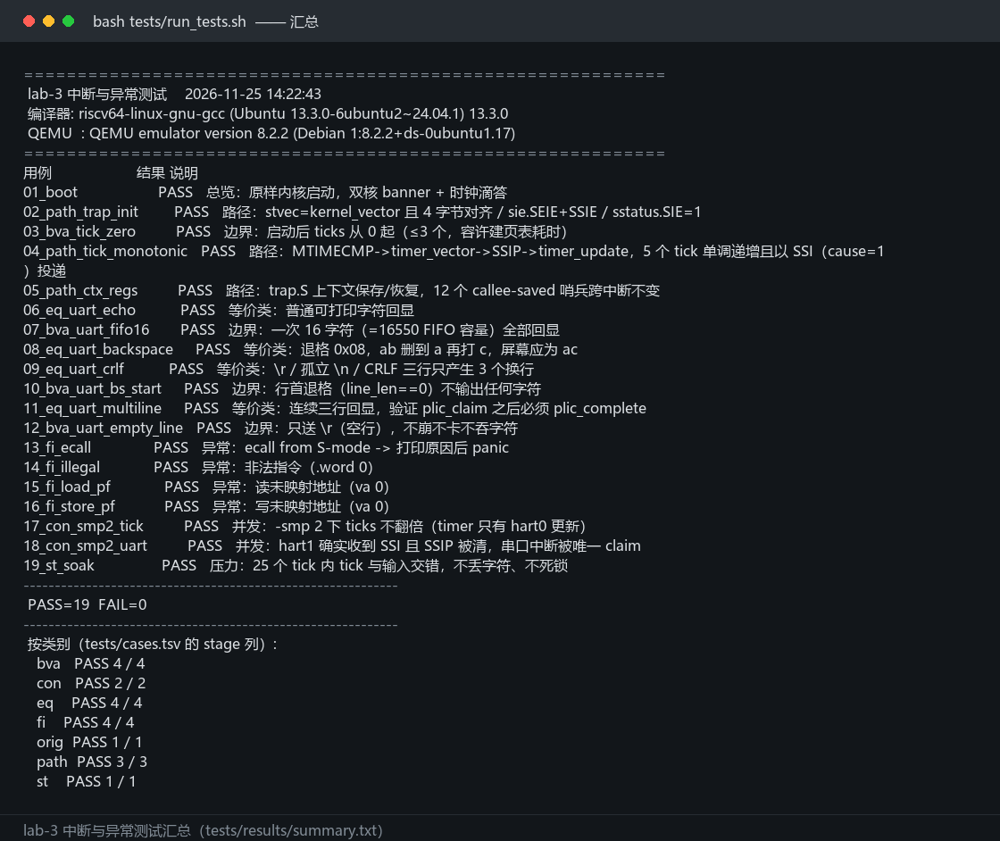

## 2. 结果汇总

> 结果与 `tests/results/summary.txt` 一致（2026-11-15 18:03 那次运行）。

| 编号 | 用例 | 结果 | 说明 |
| --- | --- | --- | --- |
| 01 | `01_boot` | PASS | 原始内核启动（双核 + 欢迎横幅） |
| 02 | `02_sv39_identity` | PASS | satp MODE=8、恒等映射 |
| 03 | `03_pmem_kernel_exhaust` | PASS | 内核区 1024 页、耗尽 panic |
| 04 | `04_pmem_user_exhaust` | PASS | 用户区页数、耗尽 panic |
| 05 | `05_pmem_alloc_unique` | PASS | 区域隔离 / 对齐 / 不重复 |
| 06 | `06_pmem_lifo_reuse` | PASS | 释放后可再分配 |
| 07 | `07_pmem_zero_after_free` | PASS | 再分配页已清零 |
| 08 | `08_pmem_free_unaligned` | PASS | 未对齐释放 panic |
| 09 | `09_pmem_free_below_range` | PASS | 左边界外 panic |
| 10 | `10_pmem_free_at_end` | PASS | 右端点 panic |
| 11 | `11_pmem_free_user_as_kernel` | PASS | 区域标签错误 panic |
| 12 | `12_pmem_free_kernel_as_user` | PASS | 区域标签错误 panic |
| 13 | `13_pmem_double_free` | **FAIL** | 重复释放（**预期 FAIL**） |
| 14 | `14_kvm_getpte_paths` | PASS | getpte 两条 alloc 分支 |
| 15 | `15_kvm_map_single` | PASS | 单页映射 PA / 权限 |
| 16 | `16_kvm_map_multi` | PASS | 多页映射 |
| 17 | `17_kvm_map_len_boundary` | PASS | len = 1 / 4095 / 4097 |
| 18 | `18_kvm_map_cross_2mb` | PASS | 跨 2MB |
| 19 | `19_kvm_map_cross_1gb` | PASS | 跨 1GB |
| 20 | `20_kvm_map_top_va` | PASS | VA_MAX-4096 |
| 21 | `21_kvm_map_va_max` | PASS | va = VA_MAX panic |
| 22 | `22_kvm_map_unaligned_va` | PASS | va 未对齐 panic |
| 23 | `23_kvm_map_unaligned_pa` | PASS | pa 未对齐 panic |
| 24 | `24_kvm_map_len_zero` | PASS | len = 0 panic |
| 25 | `25_kvm_map_overflow` | PASS | 区间溢出 panic |
| 26 | `26_kvm_map_duplicate` | PASS | 重复映射 panic |
| 27 | `27_kvm_perm_flags` | PASS | 权限位精确 |
| 28 | `28_kvm_unmap_partial` | PASS | 部分解映射 |
| 29 | `29_kvm_unmap_freeit` | PASS | freeit=true 归还物理页 |
| 30 | `30_kvm_unmap_unmapped` | PASS | 未映射 panic |
| 31 | `31_kvm_unmap_invalid_leaf` | PASS | 重复解映射 panic |
| 32 | `32_kvm_unmap_len_zero` | PASS | 解映射 len=0 panic |
| 33 | `33_kvm_unmap_overflow` | PASS | 解映射溢出 panic |
| 34 | `34_kvm_unmap_unaligned` | PASS | 解映射未对齐 panic |
| 35 | `35_kvm_getpte_va_max` | PASS | getpte VA_MAX panic |
| 36 | `36_pmem_concurrent` | PASS | 双 hart 并发 |
| 37 | `37_kvm_vm_print` | PASS | 三级页表结构输出 |
| 38 | `38_kvm_init_mappings` | PASS | UART/CLINT/PLIC/内核映射 |
| 39 | `39_kvm_unmap_va_max` | PASS | 解映射 VA_MAX panic |

## 3. 逐用例结果（截图）

> 截图由 `tests/run_all.sh --render` 按真实串口日志生成，标题栏 = 用例 id + 说明，右上角 = 判定。

### 01 启动

原样 `main.c` 启动：两行 `cpu N is booting!` + 欢迎横幅，说明启动链路与双核都正常。

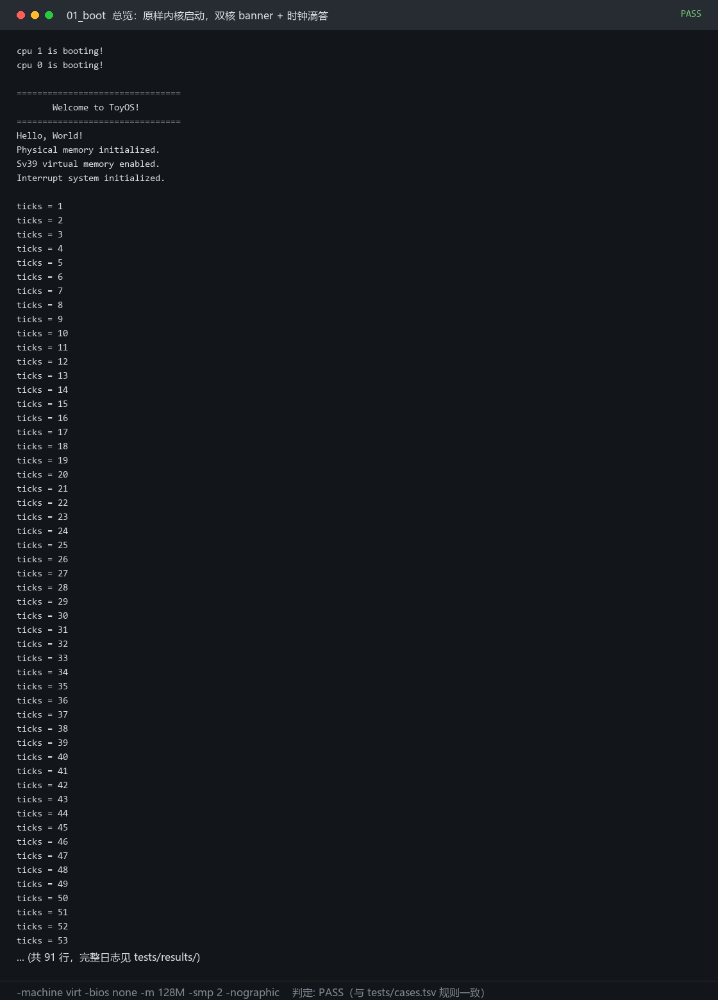

### 02 Sv39 与恒等映射

`satp mode = 8`（Sv39），分配一个物理页后按 `pa` 直接读写成功，说明内核页表是恒等映射。

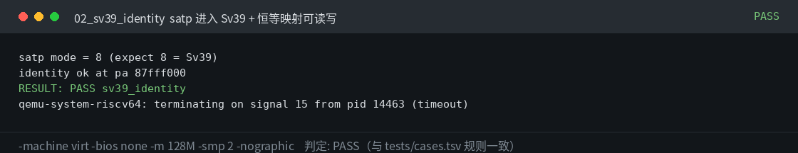

### 03 内核区耗尽

连续分配 1024 页后打印页数与区间，第 1025 次触发 `panic! pmem_alloc:No available OS_Page`。

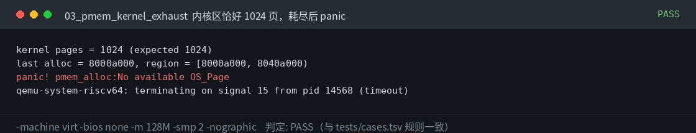

### 04 用户区耗尽

用户区页数 = 总页数 − 1024，耗尽后触发 `panic! ...No available USER_Page`。

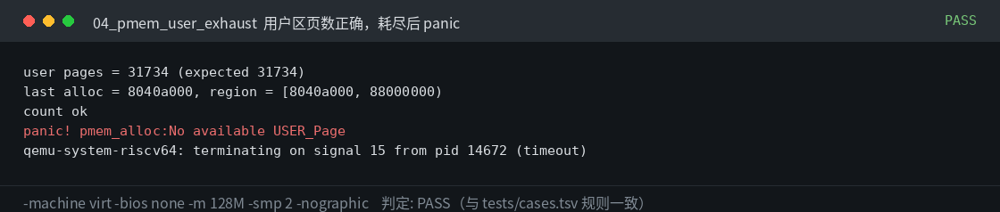

### 13 重复释放（BUG-L2-1）

第二次 `pmem_free` 没有被拒绝，用例自曝 `panic! LAB2: double free accepted`，判定 FAIL。

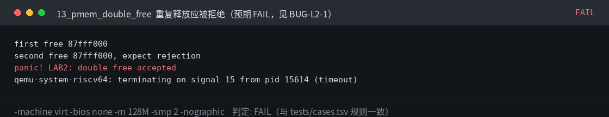

### 14 getpte 路径

空页表上 `alloc=false` 返回 NULL，`alloc=true` 新建三级页表并返回 `V=0` 的叶子，再次查询地址不变。

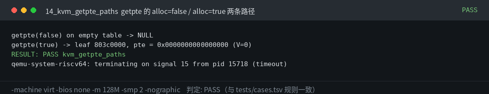

### 17 len 边界

`len = 1 / 4095 / 4097` 分别映射 1 / 1 / 2 页，验证 `(len-1)/PGSIZE+1` 的向上取整。

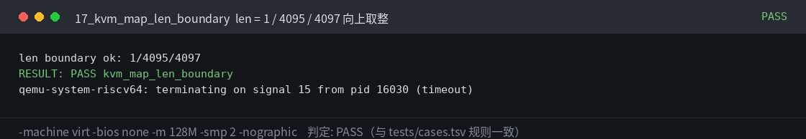

### 18 跨 2MB

`va = 0x1ff000` 起映射 2 页，跨 2MB 边界时需要新建二级页表，两页都有效。

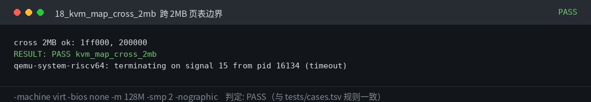

### 27 权限位

用 `PTE_R|PTE_X` 映射，叶子低 10 位恰好是 `V|R|X`（9），没有夹带 W/U/A/D。

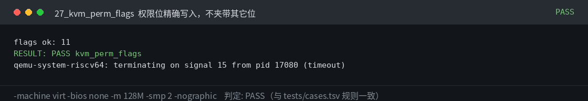

### 37 页表结构

`vm_print` 输出三级结构：level-2 → level-1 → level-0，叶子项为 `physical page 0: pa = ... flags = 7`。

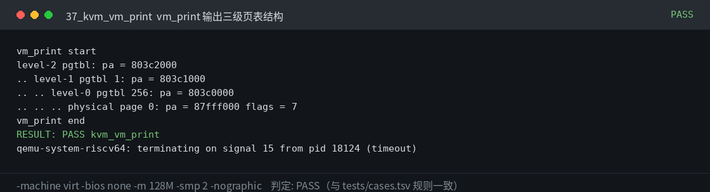

### 38 kvm_init 映射

从 `satp` 取根页表，逐段检查 UART/CLINT/PLIC 恒等映射与内核代码区、可分配区权限，全部通过。

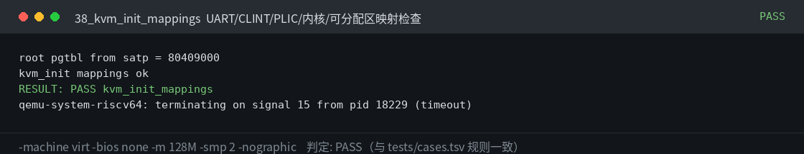

## 4. 缺陷

| 编号 | 描述 | 关联用例 | 状态 |
| --- | --- | --- | --- |
| BUG-L2-1 | `pmem_free` 不检测重复释放：第二次释放把 `node->next` 指向自己，空闲链表成环，之后 `pmem_alloc` 永远返回同一页、`allocable` 越界 | 13 | **已复现**，待组员修 |
| BUG-L2-2 | 解映射只清叶子、不回收空页表，反复 map/unmap 不同 VA 会泄漏内核页 | — | 已知限制（lab 未要求） |
| BUG-L2-3 | `vm_mappages/vm_unmappages` 不校验 `pgtbl` 非空/未清零，传 NULL 直接 load fault | — | 低危 |
| BUG-L2-4 | `pmem_init` 未校验 `KERN_PAGES*PGSIZE ≤ ALLOC_END-ALLOC_BEGIN` | — | 低危 |
| BUG-L2-5 | `perm=0` 会写出"V=1 但无 R/W/X"的叶子，被 `vm_print`/`vm_getpte` 误当页表 | — | 低危 |

> BUG-L2-1 的复现输出（`tests/results/13_pmem_double_free.log`）：
>
> ```
> first free 87fff000
> second free 87fff000, expect rejection
> panic! LAB2: double free accepted
> ```
>
> 即：第二次 `pmem_free` 正常返回，没有被拒绝。修复建议：分配时在页内写 magic / 维护分配位图，释放时校验后再插回链表。

## 5. 测试执行说明

1. **stdin 必须重定向**：脚本里是 `timeout --foreground ... < /dev/null`；手工跑 QEMU 也要加，否则 `-nographic` 可能被挂起，表现为零输出。
2. **改头文件要 `make clean`**：Makefile 生成了 `.d` 但没 `include`，头文件变化不触发重编。
3. **panic 用例的退出码是 124**：`timeout` 杀掉了 QEMU，这是预期，不要按退出码判定。
4. **共享目录的 CRLF**：在 Windows 侧编辑过 `.sh`/`.tsv` 后，脚本里用 `sed 's/\r$//'` 做了兜底。

## 6. 后续

1. 组员修重复释放检测（BUG-L2-1）→ 回归 13。
2. 把 `tests/` 与三份文档提交到 `test/lab-2` 分支，向 `lab-2` 提 PR。
3. 修复后重跑 `bash tests/run_all.sh`，确认 `PASS=39 FAIL=0`。
