# lab-1 测试报告（round2）

| 项目 | 内容 |
| --- | --- |
| 被测分支 | `lab-1`（`b1355e9e`） |
| 测试分支 | `test/lab-1-round2` |
| 测试日期 | 2026-11-14 17:06 – 17:18（Asia/Shanghai） |
| 测试环境 | VMware Workstation 17.6.4 / Ubuntu 24.04.3 LTS x86_64 |
| 工具链 | `riscv64-linux-gnu-gcc 13.3.0`、`qemu-system-riscv64 8.2.2`、`gdb-multiarch 15.1` |
| 测试代码 | `tests/`（10 个用例） |
| 启动参数 | `-machine virt -bios none -m 128M -smp 2 -nographic` |

## 1. 结论摘要

1. 基于 `main.c` 功能的 10 个用例：**9 PASS，1 FAIL**。
2. 唯一失败的是 `07_printf_percent`：`printf` 不支持 `%%`，`100%%` 会输出 `100`（**BUG-5**），这是本轮测试要暴露的缺陷。
3. 双核启动、4.1 加锁求和、单核对照、去锁对照、锁竞争、锁误用路径全部通过。
4. 测试代码已入库（`tests/`），可用 `bash tests/run_tests.sh` 复现。
5. 前提：原始 `lab-1` 在 QEMU 8.2.2 上无法启动（缺 PMP，BUG-1），本报告的结果基于本地 PMP 修复；修复需要单独提交。

**测试汇总截图：**

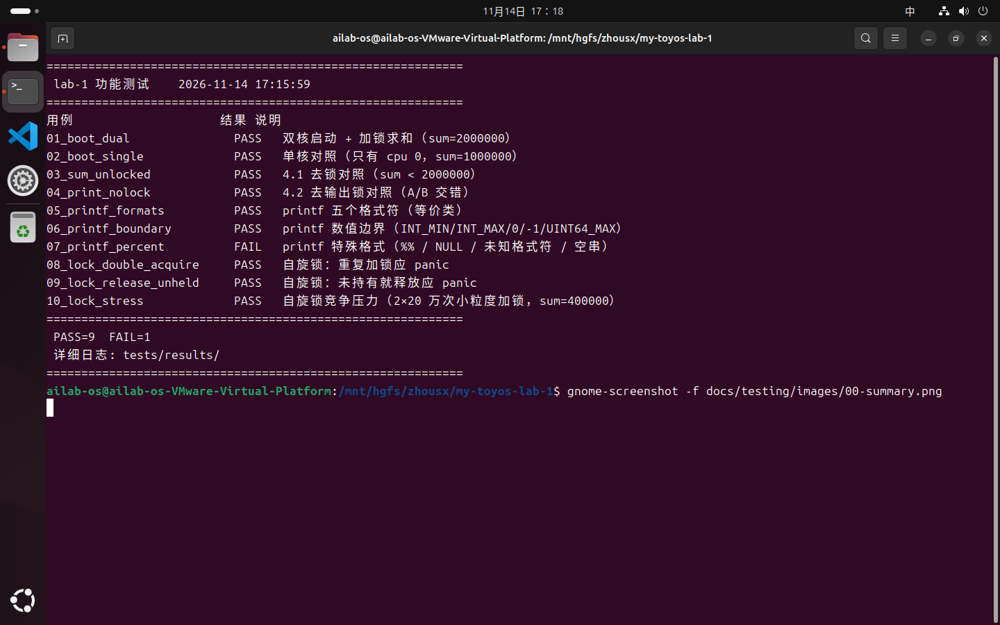

## 2. 结果汇总

| 编号 | 用例 | 结果 | 说明 |
| --- | --- | --- | --- |
| 01 | `01_boot_dual` | PASS | 双核启动；sum 最大值 2000000 |
| 02 | `02_boot_single` | PASS | 只有 cpu 0；sum=1000000 |
| 03 | `03_sum_unlocked` | PASS | 去锁后 sum 最大值 < 2000000 |
| 04 | `04_print_nolock` | PASS | 出现 A/B 字符交错 |
| 05 | `05_printf_formats` | PASS | 五个格式符全部正确 |
| 06 | `06_printf_boundary` | PASS | INT_MIN/INT_MAX/0/-1/UINT64_MAX 正确 |
| 07 | `07_printf_percent` | **FAIL** | `%%` 未输出 `%`（BUG-5） |
| 08 | `08_lock_double_acquire` | PASS | 重复加锁触发 panic |
| 09 | `09_lock_release_unheld` | PASS | 未持有释放触发 panic |
| 10 | `10_lock_stress` | PASS | 2×20 万次小粒度加锁，最大值 400000 |

## 3. 逐用例结果

### 01 双核启动 + 4.1 加锁求和

两核都进入 `main`，加锁后 `sum` 达到 2000000。

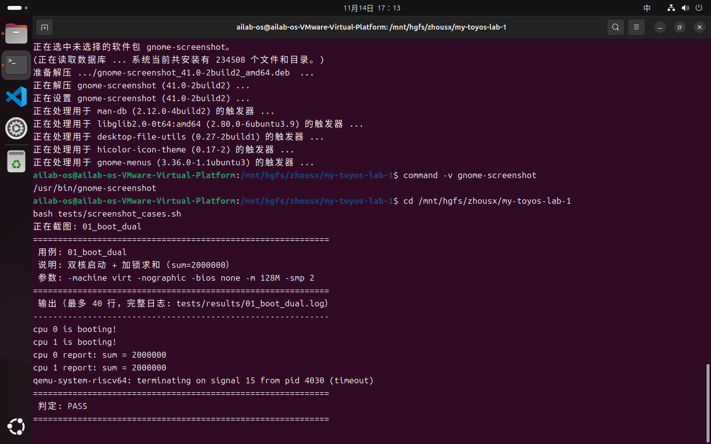

### 02 单核对照

`-smp 1` 时只有 `cpu 0`，`sum=1000000`，证明双核输出中的第二行确实来自第二个 hart。

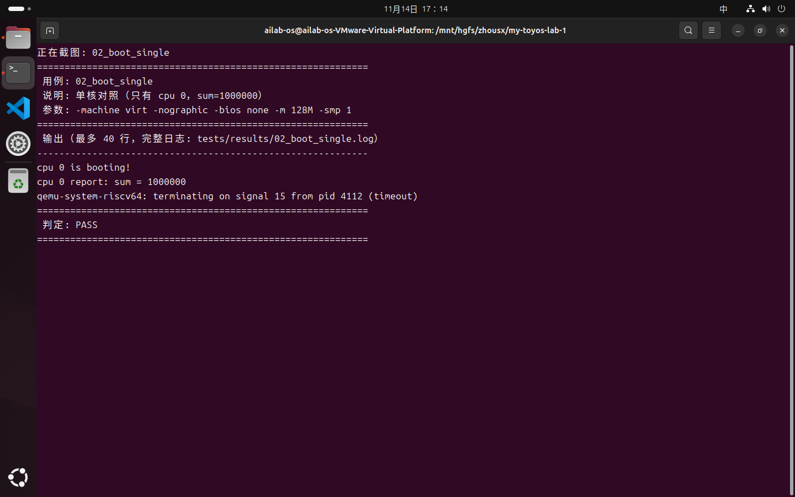

### 03 4.1 去锁对照

删除 `sum_lk` 的 acquire/release 后，最大值明显小于 2000000，丢更新复现。

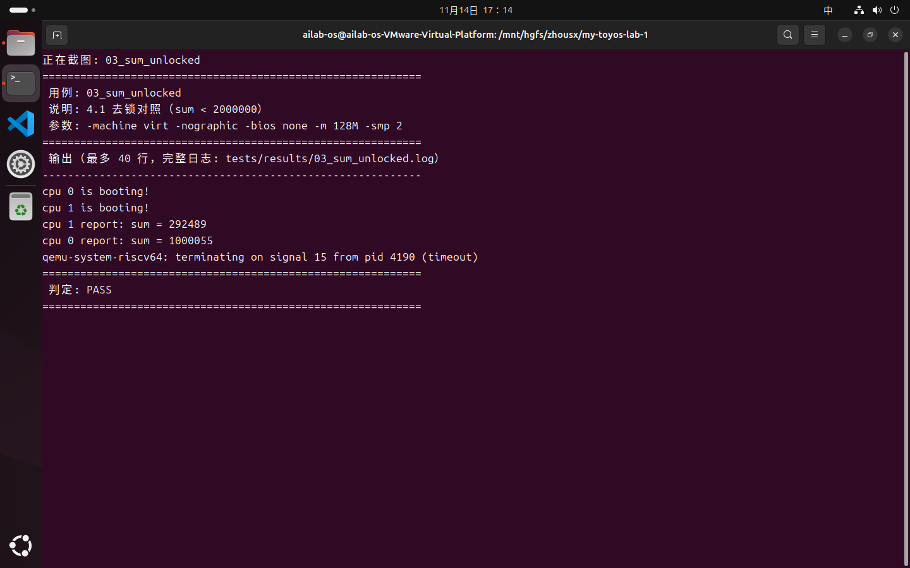

### 04 4.2 输出锁对照

删除 `print_lk` 后，两核的长串输出在字符级交错。

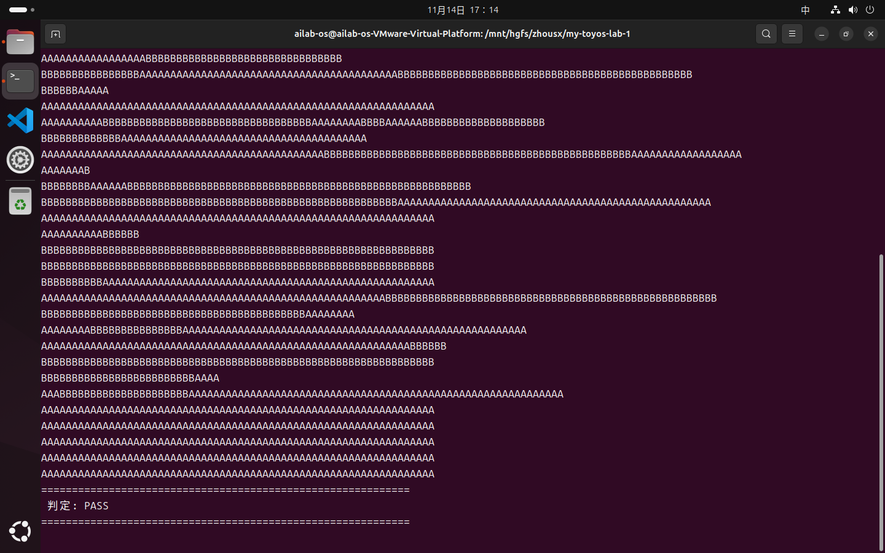

### 05 printf 五个格式符（等价类）

输出 `fmt: -123 0x123456789abcdef0 2a A ok`，`%d/%x/%p/%c/%s` 全部符合约定。

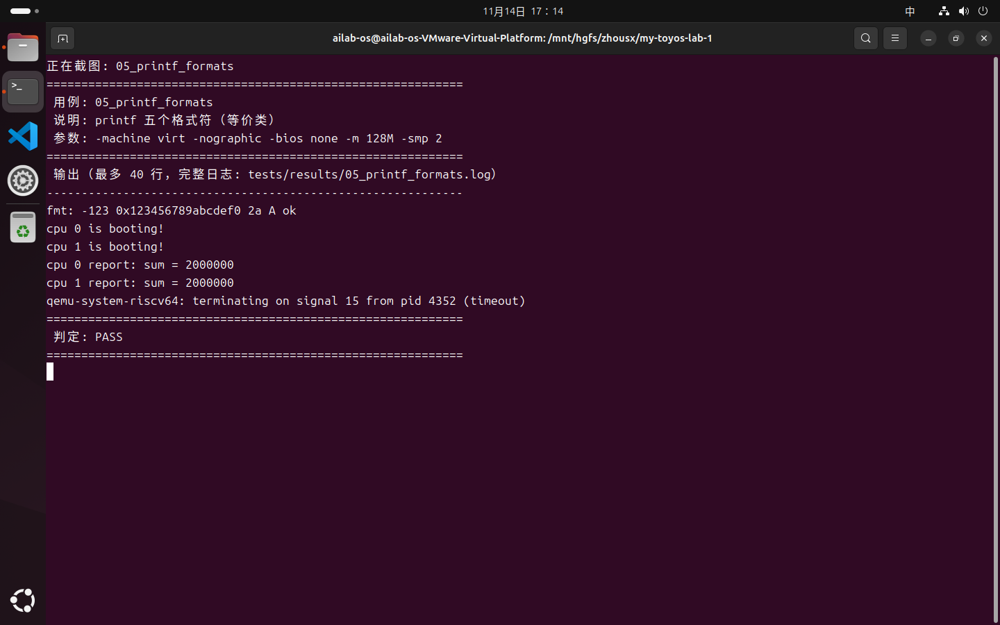

### 06 printf 数值边界（边界值）

`INT_MIN`、`INT_MAX`、`0`、`-1`、`UINT64_MAX` 五个边界值输出正确。

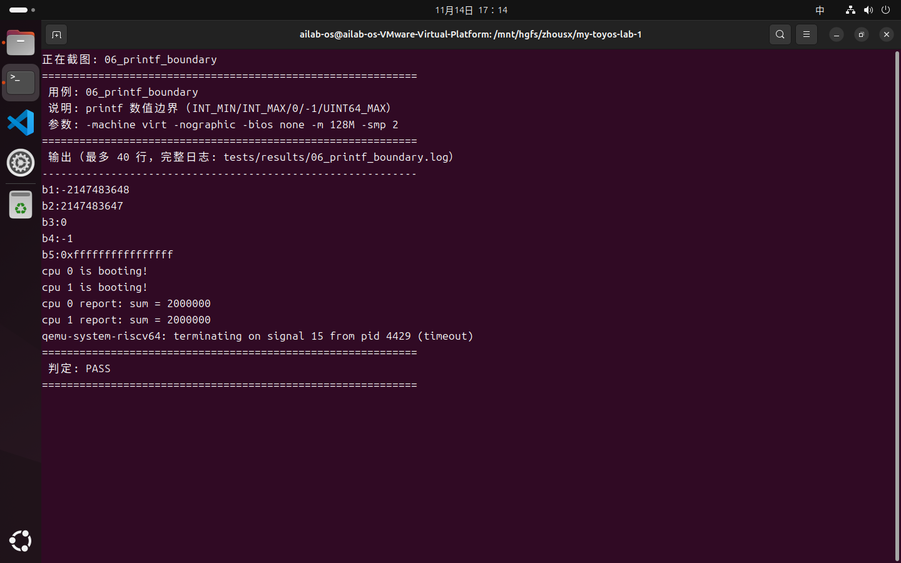

### 07 printf 特殊格式（失败，BUG-5）

`p1:%%` 和 `p4:100%%` 都没有输出 `%`，其余 NULL、`%q`、空串未崩溃。

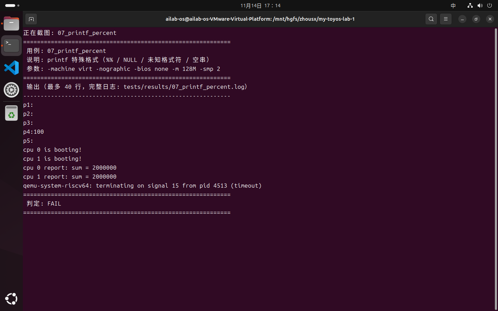

### 08 自旋锁：重复加锁

连续 acquire 两次，触发 `panic! spinlock_acquire: current CPU has hold the lock`。

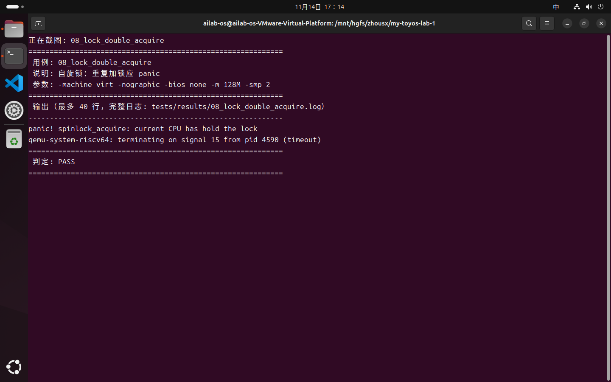

### 09 自旋锁：未持有释放

直接 release，触发 `panic! spinlock_release: current CPU does not hold the lock`。

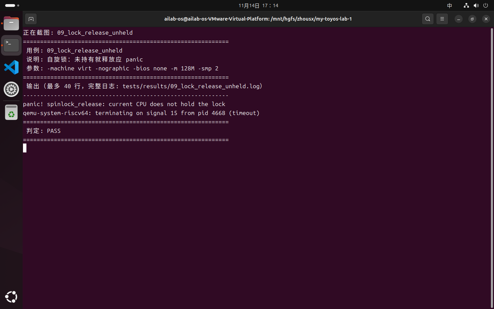

### 10 自旋锁竞争压力

两核各 20 万次小粒度加锁，最大值 400000，无丢更新、无死锁。

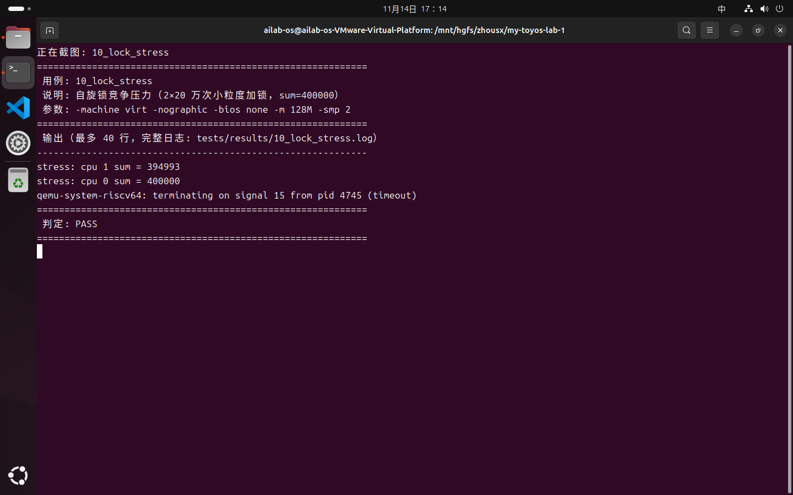

## 4. 缺陷

| 编号 | 描述 | 关联用例 | 状态 |
| --- | --- | --- | --- |
| BUG-1 | 未配置 PMP，QEMU ≥ 6.0 无法进入 S-mode | 前置条件 | 本地已修复，待单独提 PR |
| BUG-2 | `NCPU=2` 与 `-smp>2` 不匹配，多核启动越界 | 范围外 | 待修 |
| BUG-3 | 内核依赖 `-bios none` | 范围外 | 运行约束 |
| BUG-4 | Makefile：`debug` 不编译、改头文件不重编 | 范围外 | 待修 |
| BUG-5 | printf 不支持 `%%`，未知格式符被静默丢弃 | 07 | 待修 |
| BUG-6 | panic 在持有 `print_lk` 时重入，死锁 | 范围外 | 待修 |
| BUG-7 | 4KB 内核栈无保护，深调用击穿 | 范围外 | 待修 |

BUG-2/3/4/6/7 的详细复现步骤与结论见 `TESTLOG.md`（测试者本地原始记录）。

## 5. 测试环境注意事项

1. **QEMU 必须重定向 stdin**：自动化脚本里用 `< /dev/null`，否则 `timeout` 把 QEMU 放进后台进程组，QEMU 初始化终端时会被挂起，表现为"零输出"的假故障。
2. **改头文件后必须 `make clean`**：Makefile 用 `-MD` 生成 `.d` 但未 `include`，头文件变化不触发重编。
3. **`make` 不带目标等价于 `make run`**，会启动 QEMU；自动化脚本中用 `make build`。
4. 测试脚本（`tests/`）改动只在工程副本上生效，不会污染 `src/`。

## 6. 后续

1. 修复 BUG-5：在 `printf` 的 switch 中增加 `case '%': uart_putc_sync('%'); break;` 与 default 分支。
2. 按负责人安排修复 BUG-2、BUG-4、BUG-6、BUG-7。
3. 修复后重跑 `bash tests/run_tests.sh` 做回归。
