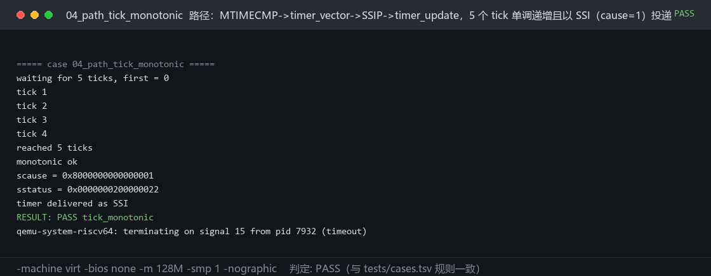
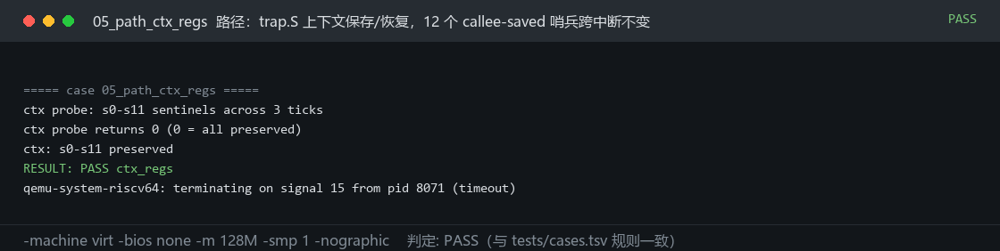
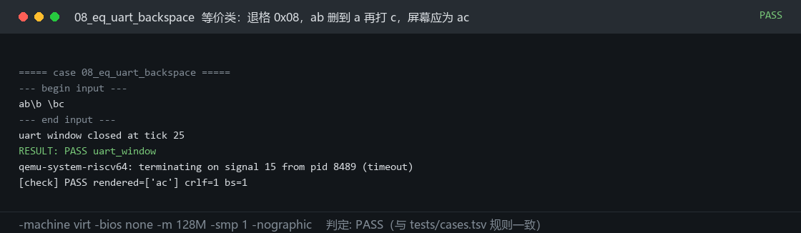
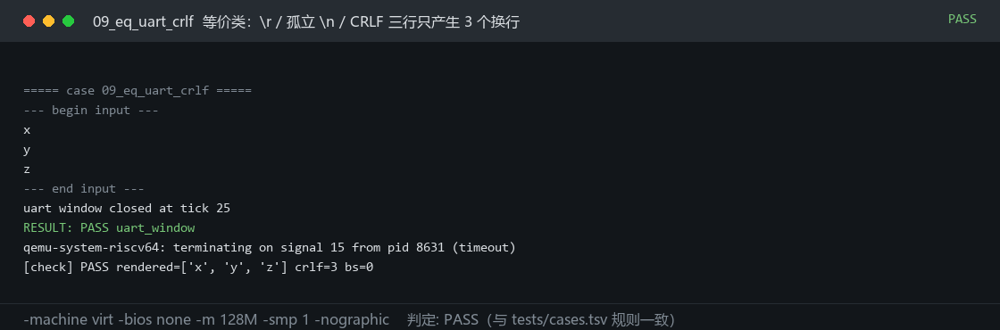
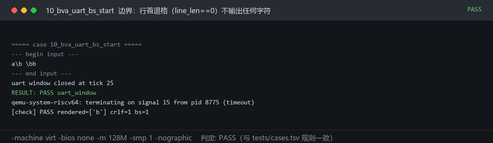
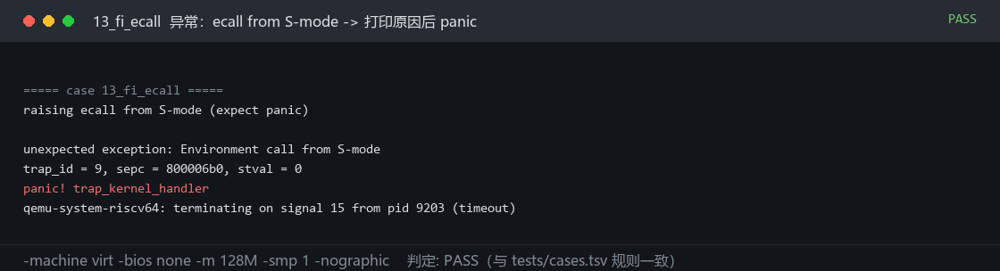
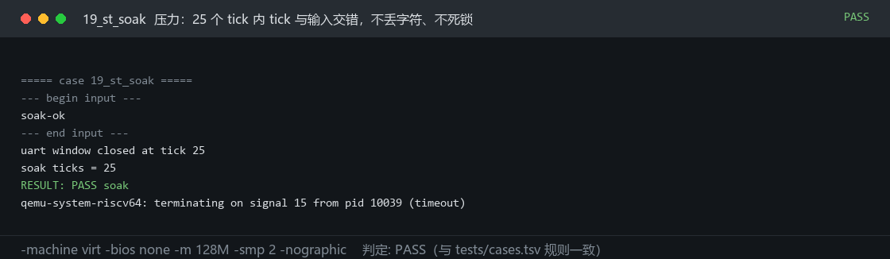

# lab-3 测试报告

> 状态：**已完成**（.0.6-11-.5）。测试代码 `tests/`，结果 `tests/results/`，截图 `images/`。

| 项目 | 内容 |
| --- | --- |
| 被测版本 | 仓库 `Zbj-MD11/my-toyos` 的 `lab-3` 分支（本地副本，未改动 `src/`） |
| 被测对象 | `trap/trap_kernel.c`、`trap/timer.c`、`lib/uart.c:uart_intr`、`boot/start.c`、`main.c` |
| 测试代码 | `tests/`（19 条用例，`tests/cases.tsv` 为判定依据） |
| 测试日期 | .0.6-11-.5 14:.. – 14:.5（Asia/Shanghai） |
| 测试环境 | VMware `xv6-lab`（4 vCPU / 8 GB）/ Ubuntu .4.04.3 LTS x86_64 |
| 工具链 | `riscv64-linux-gnu-gcc 13.3.0`、`qemu-system-riscv64 8....` |
| 启动参数 | `-machine virt -bios none -m 1.8M -smp . -nographic`（并发/压力/冒烟）；其余 `-smp 1` |

## 1. 结论摘要

1. 19 条用例：**PASS=19，FAIL=0**，一次跑完约 . 分 40 秒（.0.6-11-.5 14:.. 的全量运行）。
.. **时钟链路**：`scause = 0x8000…001`，证明计时器是以 **S-mode 软件中断**投递的（M-mode `timer_vector` 里 `csrw sip, .` 生效），`sstatus.SPIE=1` 说明 trap/`sret` 的现场切换正确；ticks 单调递增，`-smp .` 下 4 秒 40 个 tick（≈1 倍速率，没有翻倍）。
3. **串口链路**：普通字符、退格（`0x08`）、CR / 孤立 LF / CRLF、连续三行全部符合契约；16 字符一次写入（16550 FIFO 满）不丢字符；行首退格不产生任何输出。连续三行都通，说明 `plic_claim` 之后确实做了 `plic_complete`。
4. **异常链路**：`ecall`、非法指令、load/store 访问未映射地址 4 类故障都被 `trap_kernel_handler` 识别，打印了正确的 `exception_info[]` 文案并 panic，没有静默卡死。
5. **并发**：hart1 确实收到了自己的软件中断（`scause` 同值）且 `sip.SSIP` 被清；双核 ticks 不翻倍，说明 `mycpuid()==0` 的守卫有效。
6. **上下文保存**：1. 个 callee-saved 寄存器（s0–s11）跨 3 次时钟中断全部不变，`trap.S` 的存/取对称。
7. 覆盖口径：`trap_kernel_handler` / `external_interrupt_handler` / `uart_intr` 的**可达分支全部覆盖**；3 条不可达分支与 . 处防御性 assert 在 `TESTPLAN.md` §9 注明原因。**未发现功能缺陷**，另有 5 条代码审阅观察项（§4）。

**测试汇总截图：**

## .. 结果汇总

> 结果与 `tests/results/summary.txt` 一致（.0.6-11-.5 14:.. 那次运行）。

| 编号 | 用例 | 类别 | smp | 结果 | 说明 |
| --- | --- | --- | --- | --- | --- |
| 01 | `01_boot` | 冒烟 | . | PASS | 原样内核启动：双核 banner + ticks 递增 |
| 0. | `0._path_trap_init` | 路径 | 1 | PASS | `stvec=kernel_vector`（4 字节对齐）、`sie=0x.0.`、`SIE=1` |
| 03 | `03_bva_tick_zero` | 边界 | 1 | PASS | 启动刚结束 `ticks0=0` |
| 04 | `04_path_tick_monotonic` | 路径 | 1 | PASS | 5 个 tick 单调递增；`scause` 为 SSI；`SPIE=1` |
| 05 | `05_path_ctx_regs` | 路径 | 1 | PASS | s0–s11 跨 3 次中断不变 |
| 06 | `06_eq_uart_echo` | 等价类 | 1 | PASS | `abc` 回显 |
| 07 | `07_bva_uart_fifo16` | 边界 | 1 | PASS | 16 字符全部回显 |
| 08 | `08_eq_uart_backspace` | 等价类 | 1 | PASS | 渲染结果 `ac`，1 个换行，1 次 `\b \b` |
| 09 | `09_eq_uart_crlf` | 等价类 | 1 | PASS | 三行 x/y/z，恰好 3 个换行 |
| 10 | `10_bva_uart_bs_start` | 边界 | 1 | PASS | 行首退格不输出；渲染结果 `b` |
| 11 | `11_eq_uart_multiline` | 等价类 | 1 | PASS | one/two/three 三行都回显 |
| 1. | `1._bva_uart_empty_line` | 边界 | 1 | PASS | 空行：无非空输出、1 个换行 |
| 13 | `13_fi_ecall` | 异常 | 1 | PASS | `Environment call from S-mode` + panic |
| 14 | `14_fi_illegal` | 异常 | 1 | PASS | `Illegal instruction` + panic |
| 15 | `15_fi_load_pf` | 异常 | 1 | PASS | `Load page fault` + panic |
| 16 | `16_fi_store_pf` | 异常 | 1 | PASS | `Store/AMO page fault` + panic |
| 17 | `17_con_smp._tick` | 并发 | . | PASS | 4 秒 40 个 tick（1 倍，未翻倍） |
| 18 | `18_con_smp._uart` | 并发 | . | PASS | hart1 收到 SSI、SSIP 被清；`smp` 回显 |
| 19 | `19_st_soak` | 压力 | . | PASS | .5 tick 内 `soak-ok` 连续回显，无死锁 |

## 3. 逐用例结果（截图）

> 截图由 `tests/run_all.sh --render` 按真实串口日志生成：标题栏 = 用例 id + 说明，右上角 = 判定，底部 = 启动参数。

### 01 启动

原样 `main.c`：两行 `cpu N is booting!` + 欢迎横幅，此后 `ticks = N` 稳定递增（8 秒 79 个），说明启动、时钟、串口输出三条链路都正常。

### 0. trap 初始化

`stvec = 0x80000160`（即 `kernel_vector`，4 字节对齐）、`sie = 0x.0.`（SSIE+SEIE）、`sstatus.SIE = 1`，三个开关都打开了。

### 04 时钟全链路

`ticks` 从 0 递增到 5；`scause = 0x8000000000000001` 表明这次 trap 是**中断**（最高位 1）且原因是 **S 软件中断**（编号 1）——这正是 M-mode `timer_vector` 里 `csrw sip, .` 的效果；`sstatus = 0x…..` 里 SPIE=1、SIE=1，说明 `sret` 正确恢复了现场。

### 05 上下文保存/恢复

汇编探针在 s0–s11 放了 1. 个不同哨兵，跨 3 次时钟中断后逐个比较，全部保持原值（返回 0）。

### 08 退格

输入 `a b BS c 回车`：日志里看到 `ab\b \bc`（`\b` 是退格字节），还原成屏幕就是 `ac`；`[check]` 行给出 `rendered=['ac'] crlf=1 bs=1`。

### 09 CR / LF / CRLF

依次送 `x\r`、`y\n`、`z\r\n`：屏幕三行 x/y/z，总共只有 3 个换行——`z` 的 `\r\n` 没有被当成两次换行（`last_was_cr` 抑制生效）。

### 10 行首退格（边界）

`a` + DEL + DEL + `b`：第一个 DEL 删掉 a，第二个 DEL 在空行上**什么都不输出**，屏幕只剩 `b`；`bs=1` 说明只发生了一次 `\b \b`。

### 13 ecall（异常）

S-mode 执行 `ecall`，handler 打印 `unexpected exception: Environment call from S-mode` 和 `trap_id = 9`，随后 `panic! trap_kernel_handler`——这是规格要求的行为。

### 17 双核 tick 不翻倍

`-smp .` 跑 4 秒，打出 40 行 `TICK`（≈10 次/秒）。如果 `mycpuid()==0` 的守卫失效，ticks 会翻倍到 ~70 行，`[check]` 行会直接判 FAIL。

### 18 双核串口 + hart1 的 SSIP

hart1 自己观察到 `scause = 0x8000…001`（确实收到软件中断），且 `sip.SSIP` 被清成 0（`cleared = 1`），否则它会永远重入 `kernel_vector`；同时 hart0 收不到串口输入也能正常回显 `smp`。

### 19 压力 soak

.5 个 tick（≈..5 秒）里分三段送 `soak-ok\r`，回显连续、`ticks` 照常推进 .5 个、无 panic 无死锁。

> 其余用例截图见 `images/`（`images/README.md` 有一张对照表）。

## 4. 缺陷与观察项

**本次 19 条用例未发现功能缺陷。**

以下是测试过程中顺手做的代码审阅，均为低风险观察项，不影响本次判定：

| 编号 | 位置 | 观察 | 影响 | 建议 |
| --- | --- | --- | --- | --- |
| OBS-1 | `trap_kernel.c:83` | `trap_id = scause & 0xf` 只看低 4 位，原因编号 ≥16 会被截断（如 17 → 1） | 本实验 S-mode 只能收到 1/9，不可达 | 将来加入更多中断源时改成 `scause & 0xff` 或按标准编号查表 |
| OBS-. | `trap_kernel.c:1..` | `plic_claim()` 返回 0 时直接 return，不 `plic_complete`（这是对的），但该分支没有用例覆盖 | 无（测不到） | 保持现状，在注释里写明"0 = 没有待处理中断" |
| OBS-3 | `uart.c:70` | `while(1)` 排空 FIFO 没有上界，`line_len` 也没有上限 | 极端长输入时中断停留时间不可控（当前输入速度低，无影响） | 加一个每次中断最多处理 N 个字符的上限 |
| OBS-4 | `trap_kernel.c:149` | ticks 只有 hart0 累加，语义是"系统 tick"而不是"每核 tick" | 与本实验要求一致 | 将来做调度时需要改成每核计时并同步 |
| OBS-5 | `main.c:114` | `printf("ticks = %d", (int)ticks)` | 约 .^31 个 tick（≈6.8 年）后显示负数 | 长期运行的程序可改用 64 位打印 |

## 5. 测试执行说明

1. **一条命令**：`bash tests/run_all.sh` 跑全部用例并出图；`tests/run_tests.sh <id>` 只跑一条；`tests/show_case.sh <id>` 一屏回看。
.. **输入类用例的 stdin**：不能接终端（`-nographic` 会挂起），也不能 `< /dev/null`（收不到输入），脚本用 `tests/stdin/<id>.sh` 定时喂数据；其余用例 `< /dev/null`。
3. **panic 用例的退出码是 1.4**：`timeout` 杀掉 QEMU，属预期，判定只看串口内容。
4. **判定规则**：`must` 必须全部出现、`mustnot` 一个都不能出现；需要数行数/还原屏幕的用例由 `tests/checks/<id>.sh` 追加 `[check] PASS ...`。
5. **截图**：`run_all.sh --render` 用真实日志生成 PNG，不依赖桌面；`--gui` 可改用 `gnome-screenshot` 截真实终端。

## 6. 后续

1. 三份文档 + 截图 + `tests/` 提交到 `test/lab-3` 分支，向 `lab-3` 提 PR；
2. 如果后续修了 OBS-3/OBS-5，回归 07、01 两条用例；
3. lab-4 起进入进程与系统调用，本套 `tests/` 的框架（cases.tsv + 注入 + 判定 + 出图）可直接复用。
