# ToyOS Lab4 测试报告：第一个用户进程

我按《ToyOS 通用测试设计与执行模板 v2.0》整理了本次测试。执行批次为 `20261127-105726`，24 条用例全部通过。本文保留模板的六类测试及章节编号，沿用脚本中的唯一用例 ID；同一用例出现在多个分析位置时不重复计数。

## 1. 测试基本信息

| 项目 | 内容 |
|---|---|
| 项目名称 | ToyOS |
| 测试任务编号 | TEST-LAB4-001 |
| 被测 Lab / 模块 | Lab4：第一个用户进程、用户态 Trap 与系统调用 |
| 被测函数 / 接口 | `proc_pgtbl_init`、`proc_make_first`、`swtch`、`trap_user_handler`、`trap_user_return`、`user_vector`、`user_return`；相关页表映射及中断处理 |
| 接口规格 / 设计依据 | 仓库 `README.md`、`src/kernel/proc/`、`src/kernel/trap/`、`src/kernel/mem/kvm.c`、`src/user/` 当前实现 |
| 测试负责人 | zsx2006 |
| 测试设计日期 | 2026-11-27 |
| 测试执行日期 | 2026-11-27 |
| Git 分支 / Commit hash | Lab4 本地快照；本批记录未保存可核验的分支和 Commit hash，不补填 |
| 测试代码路径 / 版本 | `tests/run_tests.py`、`tests/probe.c`；对应本次执行批次，未单独打版本标签。截图作为执行证据保留，截图生成脚本不提交 |
| QEMU / 实际硬件及版本 | `qemu-system-riscv64 -machine virt -bios none`；本批日志未保存 QEMU 版本号 |
| Hart 数量 | 通常 1；`07_smp2` 为 2 |
| 物理内存配置 | 128 MiB |
| 编译器版本 / 编译选项 | `riscv64-linux-gnu-gcc`；版本号未保存。编译日志记录 `-Wall -Werror -O -mcmodel=medany -ffreestanding -fno-common -nostdlib -mno-relax` 等选项，用户程序另有 `-march=rv64g` |
| 启动命令 / Makefile 目标 | 每条用例独立执行 `make clean`、`make build`，再启动 QEMU；完整命令见对应串口日志首行 |
| 测试日志保存路径 | `tests/results/20261127-105726/`：24 份串口日志、24 份编译日志、`summary.txt`、`status.json` |
| 截图保存路径 | `docs/testing/images/20261127-105726/`：24 张用例图和 1 张汇总图 |

### 1.1 测试目标

我主要检查 proczero 能否正确建立地址空间并进入 U-mode，用户发出系统调用后能否进入内核、得到返回值并继续执行，以及用户态运行期间能否处理时钟和串口中断。对非法调用号、非法指令和越权访问，我检查当前实现规定的诊断与 panic，不能把任意崩溃当成通过。

### 1.2 被测功能与范围

本次包含启动、PID 与当前进程关联、用户与内核页表中的新增映射、首次用户态现场、系统调用、Trap 寄存器保护、swtch 上下文切换、用户内存保护及双核启动。系统调用号只有 `SYS_helloworld=0`，正常输出为 `proczero: hello world!`，返回值为 0。

当前没有进程调度和退出机制。我没有测试 fork、exit、wait、动态扩栈和堆分配，也没有重新完整测试物理页分配器。用户态异常和非法系统调用的预期处理是 panic，不能据此写成“仅终止出错进程，其他进程继续运行”。

### 1.3 前置条件与依赖

- [x] 原始启动用例通过，内存、页表和中断模块完成初始化。
- [x] 进程、页表和栈在各自独立的测试启动中建立，初始化探针检查 PID、资源指针和边界字段。
- [x] 时钟用例记录初始 ticks，检查后续至少增长 3；本次没有保存完整空闲物理页数量基线。
- [x] 每条用例独立编译、独立启动 QEMU，运行上限 5 秒；编译失败、提前退出和证据缺失均判失败。
- [x] 测试结束终止本条 QEMU，下一条重新启动。没有用进程退出或资源回收接口代替整机重置。

### 1.4 测试计划

原始脚本的 `basic` 两条在本报告归入等价类，`invalid` 与 `protection` 合并归入异常与故障测试，其余沿用原分类。这里的类别前缀仅作分类说明，不另建用例编号。

| 测试类别 | ID 前缀 | 是否适用 | 优先级 | 计划用例数 / 说明 |
|---|---|---|---|---|
| 边界值 | BVA | 适用 | P0 / P1 | 3：04、21、22 |
| 等价类 | EQ | 适用 | P0 | 2：01、03 |
| 路径覆盖 | PATH | 适用 | P0 | 5：02、05、06、23、24 |
| 并发与竞争 | CON | 适用 | P1 | 1：07；仅验证双核启动和用户态中断 |
| 异常与故障注入 | FI | 适用 | P0 | 13：08～20；非法输入和自然异常，无分配失败注入 |
| 压力与性能 | ST / PERF | 本次 N/A | — | 0：未安排长期压力负载或性能验收 |

## 2. 边界值测试（Boundary Value Analysis）

### 2.1 测试思路

页大小为 4096 字节。我检查代码页和用户栈页的首尾字节，并在异常测试中检查紧邻的未映射地址。重复系统调用使用 32 次作为代表负载，不把 32 写成内核容量上限。

### 2.2 边界值测试用例

| 用例 ID | 输入项 / 资源 | 边界说明 | 测试输入 / 步骤 | 预期结果 | 实际结果 | 状态 |
|---|---|---|---|---|---|---|
| 04_syscall_repeat | 系统调用 | 多次重复代表值 | 循环 32 次调用 0，逐次检查返回值 | 32 行 hello，无异常 | 32 行输出，返回值检查通过；[日志](../../tests/results/20261127-105726/04_syscall_repeat.log) / [图](images/20261127-105726/04_syscall_repeat.png) | 通过 |
| 21_stack_endpoints | 用户栈 | 页首、页尾 | 向 USTACK 与 USTACK+4095 写入 0x5a、0xa5 并读回 | 首尾均可读写，随后调用成功 | 读回检查通过，随后出现 hello；[日志](../../tests/results/20261127-105726/21_stack_endpoints.log) / [图](images/20261127-105726/21_stack_endpoints.png) | 通过 |
| 22_code_endpoints | 用户代码页 | 页首、页尾 | 读取 0x1000、0x1fff，随后调用 0 | 均可读取，系统调用成功 | 无访问异常，随后出现 hello；[日志](../../tests/results/20261127-105726/22_code_endpoints.log) / [图](images/20261127-105726/22_code_endpoints.png) | 通过 |

### 2.3 补充说明

`USER_BASE=0x1000`，代码页区间为 `[0x1000,0x2000)`；`USTACK=0x3fffffd000`，用户栈区间为 `[USTACK,USTACK+4096)`。`19_stack_below` 检查栈下界前一字节，`20_code_after` 检查代码页末尾后一字节，均发生预期页故障，详见第 6 节。本次没有逐一枚举所有边界组合，也没有测试栈溢出自动扩容。

## 3. 等价类测试（Equivalence Partitioning）

### 3.1 测试思路

我以调用号和用户内存访问权限划分有效、无效输入。正常调用使用 0；无效调用选 1、2147483647 和 -1。访问权限按可读写栈、可读执行代码、不可由用户访问的管理页及未映射区域区分。

### 3.2 等价类划分表

| 等价类 ID | 输入项 / 条件 | 类别说明 | 有效 / 无效 | 代表值 | 预期处理方式 / 划分依据 |
|---|---|---|---|---|---|
| EC-01 | 调用号 | 已实现系统调用 | 有效 | 0 | 输出 hello，a0=0，PC+4 |
| EC-02 | 调用号 | 未实现系统调用 | 无效 | 1、2147483647、-1 | 打印调用号并 panic |
| EC-03 | 用户页面 | 允许的访问 | 有效 | 代码读取、栈读写 | 正常访问 |
| EC-04 | 用户页面 | 不允许的访问 | 无效 | 写代码、读管理页、执行栈 | 相应类型的页故障并 panic |
| EC-05 | 用户页面 | 未映射地址 | 无效 | 0、USTACK-1、0x2000 | 页故障并 panic |

### 3.3 等价类测试用例

| 用例 ID | 等价类 ID | 输入 / 场景 | 操作步骤 | 预期结果 | 实际结果 | 状态 |
|---|---|---|---|---|---|---|
| 01_boot | EC-01 | 原始用户程序 | 保留原始 main 和 initcode，启动内核 | 启动后连续响应两次调用 | 恰有两行 hello，无 panic；[日志](../../tests/results/20261127-105726/01_boot.log) / [图](images/20261127-105726/01_boot.png) | 通过 |
| 03_syscall_once | EC-01 | 合法调用号 0 | 调用一次并判断返回值 | 一行 hello，返回值 0 | 输出和返回值符合预期；[日志](../../tests/results/20261127-105726/03_syscall_once.log) / [图](images/20261127-105726/03_syscall_once.png) | 通过 |

### 3.4 划分依据及遗漏风险

EC-02 对应 08～10，EC-03 对应 21～22，EC-04 与 EC-05 对应第 6 节的保护用例；这些只作为关联说明，不重复加入等价类主分类统计。调用号测试没有穷举全部 64 位取值，地址访问测试也没有覆盖全部权限组合。

## 4. 路径覆盖测试（Path Coverage）

### 4.1 测试思路

我使用初始化断言、Trap 路径标记、用户程序返回值检查和汇编寄存器比较验证选定路径。没有使用覆盖率工具，不把这些结果写成所有分支或所有执行路径的覆盖率。

### 4.2 控制流程 / 状态转换

```text
proc_make_first → 资源与页表初始化 → 绑定当前 Hart → swtch
  → trap_user_return → user_return → sret → U-mode
U-mode Trap → user_vector → 保存用户寄存器、恢复内核栈和页表
  → trap_user_handler
      ├─ ecall / 调用号 0：输出 hello，a0=0，保存 PC 加 4
      ├─ 软件中断：更新时钟，保存 PC 不变
      ├─ 外部中断：处理设备中断，保存 PC 不变
      └─ 非法调用或其他异常：诊断并 panic
  → trap_user_return → user_return → U-mode
```

### 4.3 路径与分支覆盖表

| 路径 ID | 函数 / 判断点 | 目标路径或分支 | 前置条件 / 触发方式 | 预期结果 | 实际路径证据 | 覆盖状态 | 测试状态 |
|---|---|---|---|---|---|---|---|
| PATH-01 | proc_make_first / proc_pgtbl_init | 初始化和映射检查 | 02_process_mapping | PID=0，用户栈与入口正确，页面权限和关键物理地址正确 | process, initial context and mappings OK | 已验证 | 通过 |
| PATH-02 | 首次 U-mode 启动 | swtch → sret → 用户 ecall | 02_process_mapping | 真正从用户态进入系统调用 | U-mode syscall entry OK，且 SPP=0 断言通过 | 已验证 | 通过 |
| PATH-03 | 系统调用返回 | 合法调用分支及用户继续执行 | 03 / 04 / 23 | a0=0，PC+4，后续调用执行 | 返回检查标记，重复次数和用户端检查通过 | 已验证 | 通过 |
| PATH-04 | 用户态软件中断 | 进入 case 1 并准备返回 | 05_user_timer | ticks 增长，保存 PC 不变 | user timer, ticks and unchanged PC OK | 已验证 | 通过 |
| PATH-05 | 用户态外部中断 | 进入 case 9，串口输入被处理 | 06_user_uart | 两段输入回显，保存 PC 不变 | user external interrupt 标记及 A/B 两段回显 | 已验证 | 通过 |
| PATH-06 | user_vector / user_return | 保存并恢复用户通用寄存器 | 23_trap_registers | 汇编比较通过后才发出第二次 ecall | 第二行 hello 与 expected syscall count reached | 已验证 | 通过 |
| PATH-07 | swtch | 切出至测试上下文，再切回 | 24_context_switch | ra、sp、s0～s11 正确恢复 | swtch ra, sp, s0-s11 roundtrip OK | 已验证 | 通过 |
| PATH-08 | 非法调用 / 用户异常 | 进入指定诊断和 panic 分支 | 08～20 | 拒绝非法输入，匹配异常类型和地址 | 对应诊断、scause/stval、panic 和最终判定 | 已验证 | 通过 |

### 4.4 覆盖情况汇总

| 覆盖项 | 计划目标数 | 已验证覆盖数 | 未覆盖数 | 证据 / 未覆盖原因 |
|---|---|---|---|---|
| 选定关键路径目标 | 8 | 8 | 0 | 上表 PATH-01～08；仅以这 8 个目标为分母 |
| 所有源码分支（真 / 假） | N/A | N/A | N/A | 没有建立完整分支清单或运行覆盖率工具 |
| 全部中断与并发交错 | N/A | N/A | N/A | 没有穷举异步事件交错 |

选定目标验证比例为 8/8，即 100%；这不是源码整体路径覆盖率。时钟和外部中断的返回 PC 标记产生在返回前检查点，能证明保存的 PC 未被加 4，不能单凭该标记声称已经验证中断后长时间用户计算的正确性。未支持的中断原因 default 分支、异常原因编号大于等于 16 的诊断分支，以及内部断言失败路径没有主动触发。

## 5. 并发与竞争测试（Concurrency Testing）

### 5.1 测试思路

我先运行单核用例，再使用双核启动同一内核。这里只存在一个用户进程；检查两个 Hart 都启动、proczero 的用户输出没有重复创建迹象，并确认用户态时钟路径仍在工作。不能据此推断锁竞争、进程调度或所有竞争条件均正确。

### 5.2 并发场景设计

| 场景 ID | 共享资源 / 临界区 | 并发执行者 | 目标交错 / 触发方法 | 必须保持的不变量 |
|---|---|---|---|---|
| CS-01 | 启动完成标志、全局初始化资源和时钟 | Hart 0 启动 proczero，Hart 1 留在内核 | -smp 2，自然启动与中断交错 | 两核各启动一次；两次合法调用恰好输出两行；用户时钟路径工作 |

### 5.3 并发测试用例

| 用例 ID | 场景 / 操作 | Hart 数 / 并发数 | 重复次数 / 超时 | 预期结果 | 实际结果 / 异常次数 | 状态 |
|---|---|---|---|---|---|---|
| 07_smp2 | CS-01，用户程序调用两次后循环 | 2 Hart / 1 用户进程 | 独立启动 1 次 / 5 秒 | 两核正常启动，用户调用和时钟处理正常 | 两核启动信息各一次，两行 hello，时钟标记通过，无非预期 panic；[日志](../../tests/results/20261127-105726/07_smp2.log) / [图](images/20261127-105726/07_smp2.png) | 通过 |

### 5.4 ToyOS 参考场景（本次适用情况）

多进程调度、fork/exit/wait、睡眠与唤醒在当前 Lab4 尚未实现，N/A。多 Hart 物理页分配和锁竞争专项测试未列入本次范围。没有测量单双核 ticks 的精确倍率，也没有设置可控竞争窗口或随机种子。

### 5.5 失败现场记录

本次没有并发用例失败现场。一次自然交错执行通过，不等于已经排除低概率竞争问题。

## 6. 异常与故障注入测试（Exception & Fault Injection Testing）

### 6.1 测试思路

我通过用户程序传入非法调用号或执行会引发异常的指令，检查真实的 Trap 处理。08～10 是非法输入，11～20 是自然硬件异常，没有伪造 scause，也没有令物理页分配函数主动失败。每条预期 panic 的用例都单独启动。

### 6.2 故障注入设计

| 故障 ID | 注入点 / 异常源 | 注入方式 | 触发条件 / 次数 | 预期错误处理 | 应回滚或释放的资源 |
|---|---|---|---|---|---|
| F-01 | 用户 ecall | a7=1、2147483647、-1 | 每条独立启动，各触发一次 | 打印未知调用号并进入指定 panic | 当前错误分支不返回；整机重启隔离下一条 |
| F-02 | 用户指令 | 非法编码、读取 sstatus | 每条各一次 | Illegal instruction，scause=2，panic | 同上 |
| F-03 | 用户数据访问 | 未映射或越权的 load / store | 每条各一次 | 对应页故障，检查 stval，panic | 同上 |
| F-04 | 用户取指 | 跳转到用户栈 | 一次 | Instruction page fault，scause=12，panic | 同上 |

### 6.3 异常与故障测试用例

| 用例 ID | 故障 ID / 场景 | 触发步骤 | 预期结果及恢复行为 | 实际结果 | 资源前后差异 / 证据 | 状态 |
|---|---|---|---|---|---|---|
| 08_unknown_one | 相邻非法调用号；F-01 | 调用 syscall(1) | 打印未知调用号 1，panic: unknown syscall | 诊断与指定 panic 匹配 | 整机重启隔离；[日志](../../tests/results/20261127-105726/08_unknown_one.log) / [图](images/20261127-105726/08_unknown_one.png) | 通过 |
| 09_unknown_large | 大整数调用号；F-01 | 调用 syscall(2147483647) | 打印未知调用号 2147483647，panic: unknown syscall | 诊断与指定 panic 匹配 | 整机重启隔离；[日志](../../tests/results/20261127-105726/09_unknown_large.log) / [图](images/20261127-105726/09_unknown_large.png) | 通过 |
| 10_unknown_negative | 负调用号；F-01 | 调用 syscall(-1) | 打印未知调用号 -1，panic: unknown syscall | 诊断与指定 panic 匹配 | 整机重启隔离；[日志](../../tests/results/20261127-105726/10_unknown_negative.log) / [图](images/20261127-105726/10_unknown_negative.png) | 通过 |
| 11_illegal | 非法指令；F-02 | .word 0 | Illegal instruction；scause=2；panic | scause=2，stval=0x0000000000000000 | 整机重启隔离；[日志](../../tests/results/20261127-105726/11_illegal.log) / [图](images/20261127-105726/11_illegal.png) | 通过 |
| 12_privileged | 用户态执行特权指令；F-02 | U-mode 读取 sstatus | Illegal instruction；scause=2；panic | scause=2，stval=0x00000000100022f3 | 整机重启隔离；[日志](../../tests/results/20261127-105726/12_privileged.log) / [图](images/20261127-105726/12_privileged.png) | 通过 |
| 13_zero_read | 地址 0 读取；F-03 | ld 地址 0 | Load page fault；scause=13；panic | scause=13，stval=0x0000000000000000 | 整机重启隔离；[日志](../../tests/results/20261127-105726/13_zero_read.log) / [图](images/20261127-105726/13_zero_read.png) | 通过 |
| 14_zero_write | 地址 0 写入；F-03 | sd 地址 0 | Store/AMO page fault；scause=15；panic | scause=15，stval=0x0000000000000000 | 整机重启隔离；[日志](../../tests/results/20261127-105726/14_zero_write.log) / [图](images/20261127-105726/14_zero_write.png) | 通过 |
| 15_code_write | 只读代码页写入；F-03 | sb 地址 0x1000 | Store/AMO page fault；scause=15；panic | scause=15，stval=0x0000000000001000 | 整机重启隔离；[日志](../../tests/results/20261127-105726/15_code_write.log) / [图](images/20261127-105726/15_code_write.png) | 通过 |
| 16_trapframe_read | 用户读取 trapframe；F-03 | ld 地址 0x3fffffe000 | Load page fault；scause=13；panic | scause=13，stval=0x0000003fffffe000 | 整机重启隔离；[日志](../../tests/results/20261127-105726/16_trapframe_read.log) / [图](images/20261127-105726/16_trapframe_read.png) | 通过 |
| 17_trampoline_read | 用户读取 trampoline；F-03 | ld 地址 0x3ffffff000 | Load page fault；scause=13；panic | scause=13，stval=0x0000003ffffff000 | 整机重启隔离；[日志](../../tests/results/20261127-105726/17_trampoline_read.log) / [图](images/20261127-105726/17_trampoline_read.png) | 通过 |
| 18_stack_execute | 用户栈执行指令；F-04 | 跳转 0x3fffffd000 | Instruction page fault；scause=12；panic | scause=12，stval=0x0000003fffffd000 | 整机重启隔离；[日志](../../tests/results/20261127-105726/18_stack_execute.log) / [图](images/20261127-105726/18_stack_execute.png) | 通过 |
| 19_stack_below | 用户栈下界外读取；F-03 | 读取 0x3fffffcfff | Load page fault；scause=13；panic | scause=13，stval=0x0000003fffffcfff | 整机重启隔离；[日志](../../tests/results/20261127-105726/19_stack_below.log) / [图](images/20261127-105726/19_stack_below.png) | 通过 |
| 20_code_after | 代码页上界外读取；F-03 | 读取 0x2000 | Load page fault；scause=13；panic | scause=13，stval=0x0000000000002000 | 整机重启隔离；[日志](../../tests/results/20261127-105726/20_code_after.log) / [图](images/20261127-105726/20_code_after.png) | 通过 |

### 6.4 ToyOS 参考场景（本次适用情况）

本次覆盖 Trap 用户异常和未知调用号。fork、mmap、brk 的失败回滚不属于当前实现范围；没有人为破坏内核不变量，也没有验证内存耗尽后的回滚。

### 6.5 恢复与清理检查

- [x] 非法调用诊断、异常原因和适用时的故障地址符合本条预期。
- [x] 各条用例独立运行，前一条 panic 不影响下一条启动。
- [x] 正常程序通过 01、03 等独立用例验证；测试替换与探针只写入隔离构建。
- 资源释放 / 恢复：N/A。当前错误处理终止内核，未验证锁、物理页或页表的正常回收。
- 未受影响进程继续运行：N/A。当前仅有 proczero，且 panic 不提供进程级隔离恢复。

## 7. 压力与性能测试（Stress & Performance Testing）

### 7.1 测试思路

本次验收针对功能，没有预设长时间运行负载、性能阈值或基准版本。32 次系统调用用于验证重复调用的正确性，5 秒是单条 QEMU 的运行上限，两者都不作为性能数据。

### 7.2 压力测试用例

N/A。本次没有独立的长期压力用例，不把 04 另计为 ST 用例。

### 7.3 性能测试用例

N/A。没有采集系统调用或上下文切换的耗时样本，没有进行预热和重复测量。

### 7.4 性能结果与资源统计

| 指标 | 单位 | 基准值 | 当前值 | 差异 / 结论 |
|---|---|---|---|---|
| 平均操作耗时 | cycles / μs | N/A | 未测 | 不作结论 |
| P95 操作耗时 | cycles / μs | N/A | 未测 | 不作结论 |
| 吞吐量 | 次 / 秒 | N/A | 未测 | 不作结论 |
| 平均就绪等待时间 | ticks | N/A | 未测 | 不作结论 |
| 平均首次响应时间 | ticks | N/A | 未测 | 不作结论 |
| 上下文切换总次数 | 次 | N/A | 未测 | 不作结论 |
| 前后可用物理页差值 | 页 | N/A | 未测 | 不作结论 |

没有性能原始数据文件。时钟探针仅验证 ticks 至少增长 3，不提供时延、吞吐或资源泄漏结论。

## 8. 单条测试用例详细记录

### 用例：`06_user_uart`

| 项目 | 内容 |
|---|---|
| 用例名称 | 用户态串口中断 |
| 主测试类别 / 关联类别 | 路径覆盖 / 中断交互 |
| 优先级 | P0 |
| 关联需求 / 函数 / 路径 ID | PATH-05；trap_user_handler、external_interrupt_handler |
| 前置条件与初始资源状态 | 单核，用户程序调用一次后循环；两段输入在启动 QEMU 后约 1 秒、2 秒送入 |
| 测试数据 / 配置 | lab4-uart-A\n、lab4-uart-B\n |
| 测试程序路径及执行命令 | `tests/run_tests.py`、`tests/probe.c`；`python3 tests/run_tests.py --case 06_user_uart` |
| 预期结果 / 判定标准 | 两段输入均回显，用户态外部中断标记、用户时钟标记和最终 PASS 均出现 |
| 超时与重复次数 | 5 秒，独立启动 1 次 |
| 实际结果 | 预期证据齐全，最终 [check] PASS |
| 执行版本 / 人员 / 日期 | 批次 20261127-105726 / zsx2006 / 2026-11-27 |
| 状态 | 通过 |
| 证据 / 日志路径 | [日志](../../tests/results/20261127-105726/06_user_uart.log) / [图](images/20261127-105726/06_user_uart.png) |
| 关联缺陷 ID | 无 |

执行步骤：独立复制并编译测试构建，启动 QEMU，执行本条用户程序或上下文测试，采集串口记录并检查断言；到达运行上限后终止本条 QEMU。

执行日志（从本次原始日志摘录，保留原有顺序）：

```text
[probe] process, initial context and mappings OK
[probe] U-mode syscall entry OK
[probe] syscall return a0=0, PC+4 OK
[probe] expected syscall count reached
[probe] user external interrupt and unchanged PC OK
[probe] user timer, ticks and unchanged PC OK
lab4-uart-A
lab4-uart-B
[check] PASS all assertions satisfied
```

### 用例：`16_trapframe_read`

| 项目 | 内容 |
|---|---|
| 用例名称 | 用户读取 trapframe |
| 主测试类别 / 关联类别 | 异常与故障 / 内存保护 |
| 优先级 | P0 |
| 关联需求 / 函数 / 路径 ID | F-03；用户页表权限与 trap_user_handler |
| 前置条件与初始资源状态 | 单核，初始化检查通过，用户程序先调用一次合法 syscall，再执行越权读取 |
| 测试数据 / 配置 | 地址 0x3fffffe000 |
| 测试程序路径及执行命令 | `tests/run_tests.py`、`tests/probe.c`；`python3 tests/run_tests.py --case 16_trapframe_read` |
| 预期结果 / 判定标准 | Load page fault，scause=13，stval=0x3fffffe000，panic! trap_user_handler |
| 超时与重复次数 | 5 秒，独立启动 1 次 |
| 实际结果 | 预期证据齐全，最终 [check] PASS |
| 执行版本 / 人员 / 日期 | 批次 20261127-105726 / zsx2006 / 2026-11-27 |
| 状态 | 通过 |
| 证据 / 日志路径 | [日志](../../tests/results/20261127-105726/16_trapframe_read.log) / [图](images/20261127-105726/16_trapframe_read.png) |
| 关联缺陷 ID | 无 |

执行步骤：独立复制并编译测试构建，启动 QEMU，执行本条用户程序或上下文测试，采集串口记录并检查断言；到达运行上限后终止本条 QEMU。

执行日志（从本次原始日志摘录，保留原有顺序）：

```text
[probe] process, initial context and mappings OK
[probe] U-mode syscall entry OK
[probe] syscall return a0=0, PC+4 OK
[probe] expected syscall count reached
[probe] user external interrupt and unchanged PC OK
unexpected user exception: Load page fault
scause = 0x000000000000000d, sepc = 0x0000000000001020, stval = 0x0000003fffffe000
panic! trap_user_handler
[check] PASS all assertions satisfied
```

### 用例：`24_context_switch`

| 项目 | 内容 |
|---|---|
| 用例名称 | swtch 上下文往返 |
| 主测试类别 / 关联类别 | 路径覆盖 / 寄存器恢复 |
| 优先级 | P0 |
| 关联需求 / 函数 / 路径 ID | PATH-07；swtch |
| 前置条件与初始资源状态 | 单核，建立独立测试上下文和栈，在正式切入用户态前完成往返 |
| 测试数据 / 配置 | ra、sp、s0～s11；s0～s11 使用 800～811 作为哨兵值 |
| 测试程序路径及执行命令 | `tests/run_tests.py`、`tests/probe.c`；`python3 tests/run_tests.py --case 24_context_switch` |
| 预期结果 / 判定标准 | swtch ra, sp, s0-s11 roundtrip OK，随后用户程序调用成功 |
| 超时与重复次数 | 5 秒，独立启动 1 次 |
| 实际结果 | 预期证据齐全，最终 [check] PASS |
| 执行版本 / 人员 / 日期 | 批次 20261127-105726 / zsx2006 / 2026-11-27 |
| 状态 | 通过 |
| 证据 / 日志路径 | [日志](../../tests/results/20261127-105726/24_context_switch.log) / [图](images/20261127-105726/24_context_switch.png) |
| 关联缺陷 ID | 无 |

执行步骤：独立复制并编译测试构建，启动 QEMU，执行本条用户程序或上下文测试，采集串口记录并检查断言；到达运行上限后终止本条 QEMU。

执行日志（从本次原始日志摘录，保留原有顺序）：

```text
[probe] swtch ra, sp, s0-s11 roundtrip OK
[probe] process, initial context and mappings OK
[probe] U-mode syscall entry OK
[probe] syscall return a0=0, PC+4 OK
[probe] expected syscall count reached
[probe] user external interrupt and unchanged PC OK
[probe] user timer, ticks and unchanged PC OK
[check] PASS all assertions satisfied
```

## 10. 测试结果汇总

### 10.1 执行统计

| 主测试类别 | 计划数 | 通过 | 失败 | 阻塞 | 未执行 | 不适用 |
|---|---|---|---|---|---|---|
| 边界值 | 3 | 3 | 0 | 0 | 0 | — |
| 等价类 | 2 | 2 | 0 | 0 | 0 | — |
| 路径覆盖 | 5 | 5 | 0 | 0 | 0 | — |
| 并发与竞争 | 1 | 1 | 0 | 0 | 0 | — |
| 异常与故障注入 | 13 | 13 | 0 | 0 | 0 | — |
| 压力与性能 | 0 | 0 | 0 | 0 | 0 | 本次整类 N/A，无分配用例 ID |
| 合计（按用例 ID 去重） | 24 | 24 | 0 | 0 | 0 | — |

已执行并得出结论 24 条，通过率为 `24 / (24 + 0) × 100% = 100%`。本批没有阻塞或未执行的计划用例。主分类与脚本原分类的对应规则见 1.4，不因跨类引用增加用例数。

独立回归批次：未安排，不额外计数。此前单条启动冒烟记录不并入本批统计。

[原始汇总](../../tests/results/20261127-105726/summary.txt) · [机器判定](../../tests/results/20261127-105726/status.json)

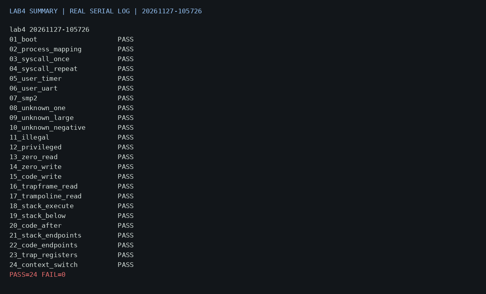

### 10.2 缺陷记录

本次 24 条用例未发现不符合当前功能约定的内核缺陷，没有新建缺陷编号。08～20 中的 panic 与各条异常预期一致，不登记为缺陷。未测范围不作为已排除问题。

### 10.3 测试结论

- [x] 通过：本次计划内关键验收条件均满足，没有观察到阻断性缺陷。
- [ ] 有条件通过。
- [ ] 不通过。
- [ ] 未完成。

我完成了 24 条测试，确认第一个用户进程可以启动并响应系统调用；选定的初始化、页表权限、Trap 现场保护、上下文切换、用户态时钟与串口中断检查均通过。非法调用和所测越权访问也进入了当前实现规定的诊断与 panic 分支。

结论限定在这些用例和本次执行批次内。双核只进行一次自然交错测试，没有验证精确 tick 倍率或长期竞争；中断检查没有验证长时间用户计算结果；长期压力、性能和错误后的进程级恢复未测。分支、Commit hash 及工具版本号没有在本批记录中保存，后续不能用猜测值补齐。

## 附录：全部用例截图与原始记录

以下 24 张图由本次真实串口日志渲染，均保留最终判定。异常截图中的红色 panic 是预期输出。每张图与唯一用例 ID 对应，汇总图另计，因此本批共 25 张图片。

### `01_boot`：原始程序启动

[串口日志](../../tests/results/20261127-105726/01_boot.log) · [编译日志](../../tests/results/20261127-105726/01_boot.build.log)

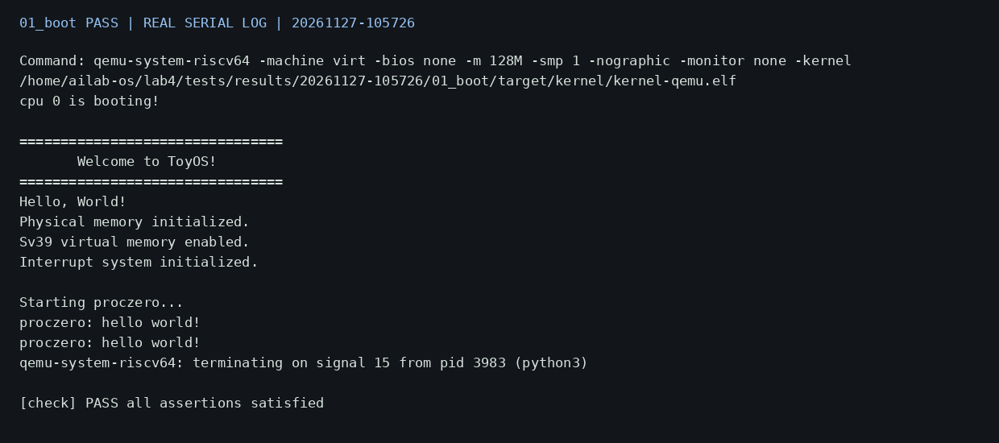

### `02_process_mapping`：进程初始化与页表映射

[串口日志](../../tests/results/20261127-105726/02_process_mapping.log) · [编译日志](../../tests/results/20261127-105726/02_process_mapping.build.log)

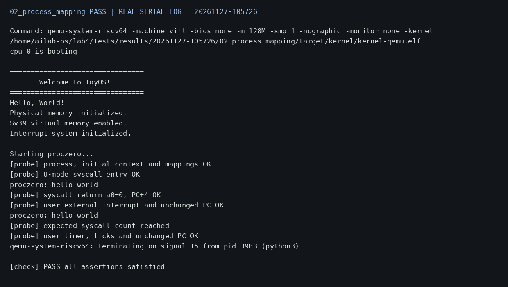

### `03_syscall_once`：单次系统调用

[串口日志](../../tests/results/20261127-105726/03_syscall_once.log) · [编译日志](../../tests/results/20261127-105726/03_syscall_once.build.log)

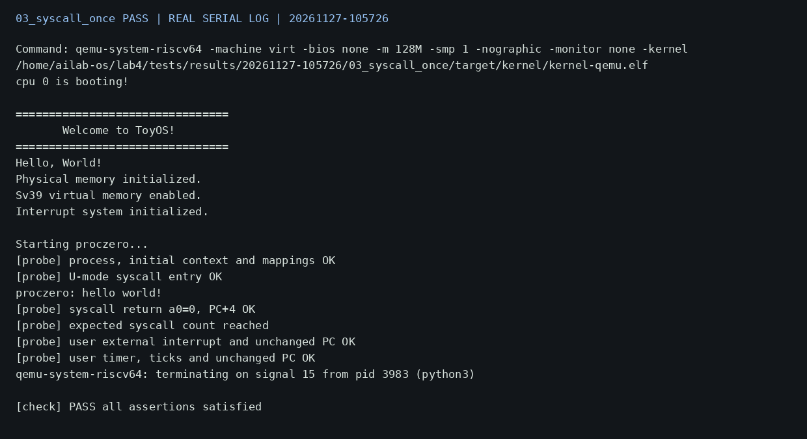

### `04_syscall_repeat`：连续 32 次系统调用

[串口日志](../../tests/results/20261127-105726/04_syscall_repeat.log) · [编译日志](../../tests/results/20261127-105726/04_syscall_repeat.build.log)

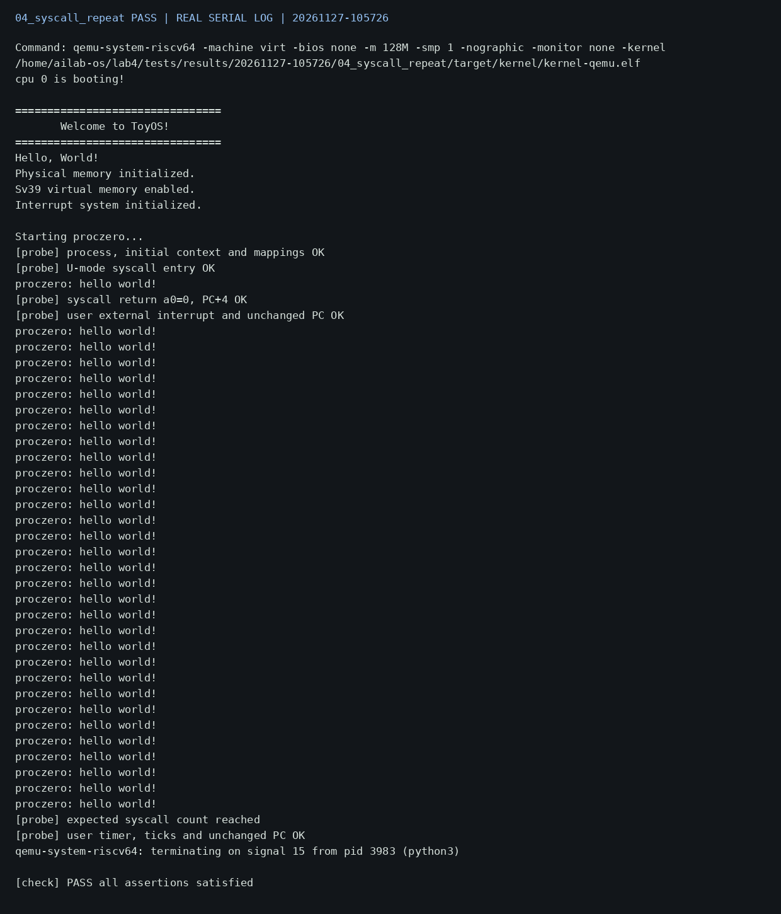

### `05_user_timer`：用户态时钟中断

[串口日志](../../tests/results/20261127-105726/05_user_timer.log) · [编译日志](../../tests/results/20261127-105726/05_user_timer.build.log)

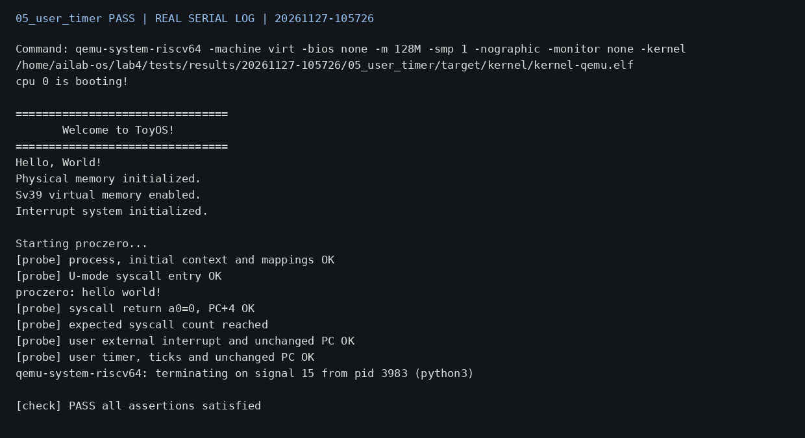

### `06_user_uart`：用户态串口中断

[串口日志](../../tests/results/20261127-105726/06_user_uart.log) · [编译日志](../../tests/results/20261127-105726/06_user_uart.build.log)

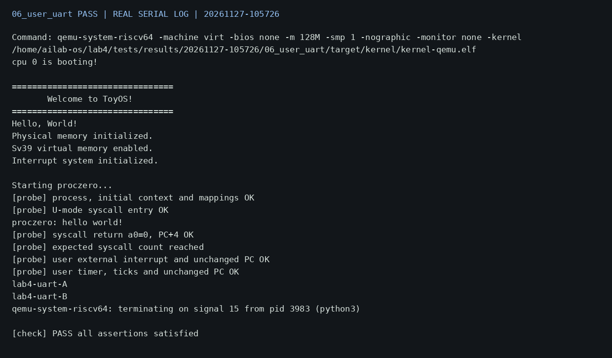

### `07_smp2`：双核启动与单用户进程

[串口日志](../../tests/results/20261127-105726/07_smp2.log) · [编译日志](../../tests/results/20261127-105726/07_smp2.build.log)

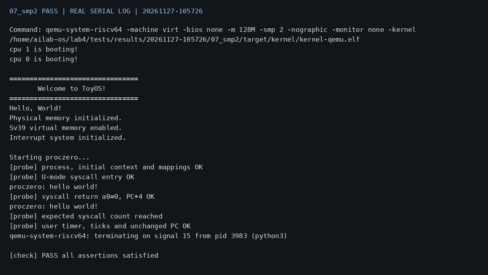

### `08_unknown_one`：相邻非法调用号

[串口日志](../../tests/results/20261127-105726/08_unknown_one.log) · [编译日志](../../tests/results/20261127-105726/08_unknown_one.build.log)


### `09_unknown_large`：大整数调用号

[串口日志](../../tests/results/20261127-105726/09_unknown_large.log) · [编译日志](../../tests/results/20261127-105726/09_unknown_large.build.log)

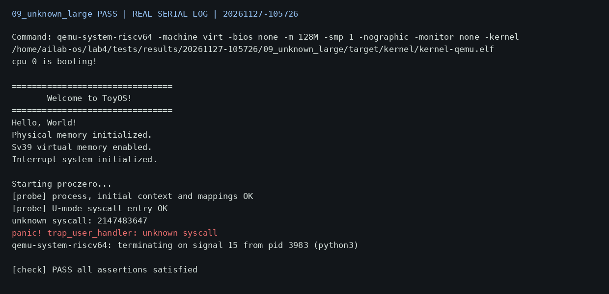

### `10_unknown_negative`：负调用号

[串口日志](../../tests/results/20261127-105726/10_unknown_negative.log) · [编译日志](../../tests/results/20261127-105726/10_unknown_negative.build.log)

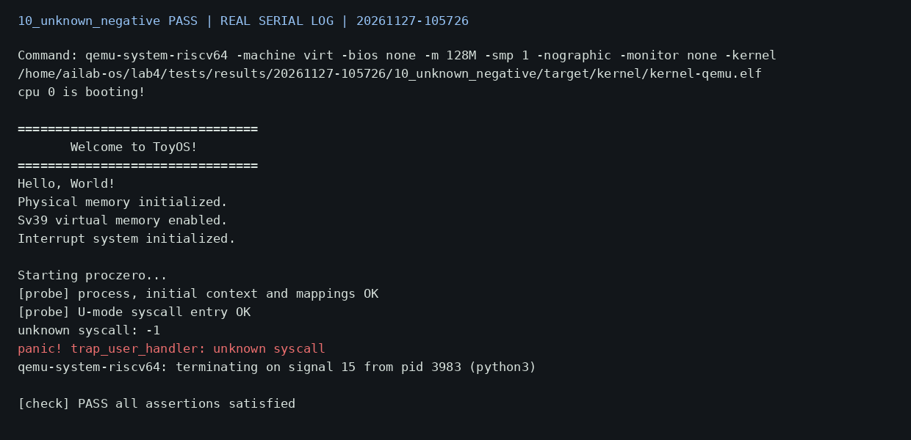

### `11_illegal`：非法指令

[串口日志](../../tests/results/20261127-105726/11_illegal.log) · [编译日志](../../tests/results/20261127-105726/11_illegal.build.log)

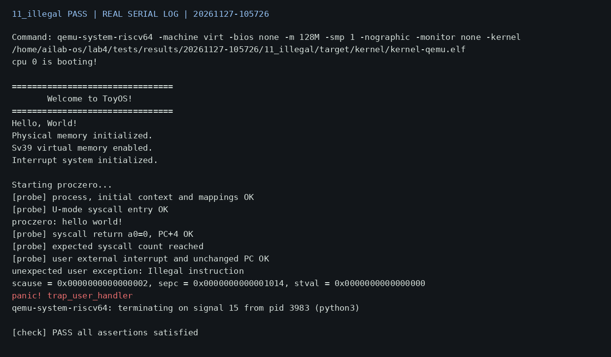

### `12_privileged`：用户态执行特权指令

[串口日志](../../tests/results/20261127-105726/12_privileged.log) · [编译日志](../../tests/results/20261127-105726/12_privileged.build.log)

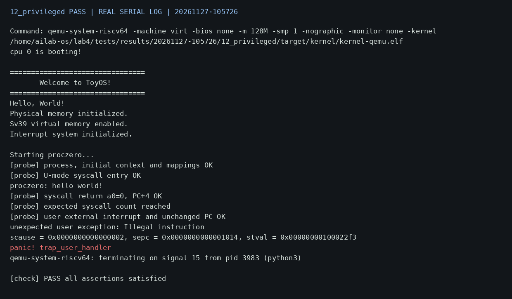

### `13_zero_read`：地址 0 读取

[串口日志](../../tests/results/20261127-105726/13_zero_read.log) · [编译日志](../../tests/results/20261127-105726/13_zero_read.build.log)


### `14_zero_write`：地址 0 写入

[串口日志](../../tests/results/20261127-105726/14_zero_write.log) · [编译日志](../../tests/results/20261127-105726/14_zero_write.build.log)


### `15_code_write`：只读代码页写入

[串口日志](../../tests/results/20261127-105726/15_code_write.log) · [编译日志](../../tests/results/20261127-105726/15_code_write.build.log)

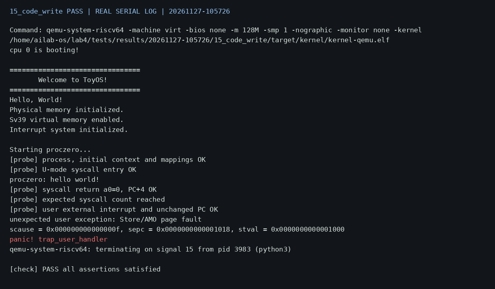

### `16_trapframe_read`：用户读取 trapframe

[串口日志](../../tests/results/20261127-105726/16_trapframe_read.log) · [编译日志](../../tests/results/20261127-105726/16_trapframe_read.build.log)


### `17_trampoline_read`：用户读取 trampoline

[串口日志](../../tests/results/20261127-105726/17_trampoline_read.log) · [编译日志](../../tests/results/20261127-105726/17_trampoline_read.build.log)

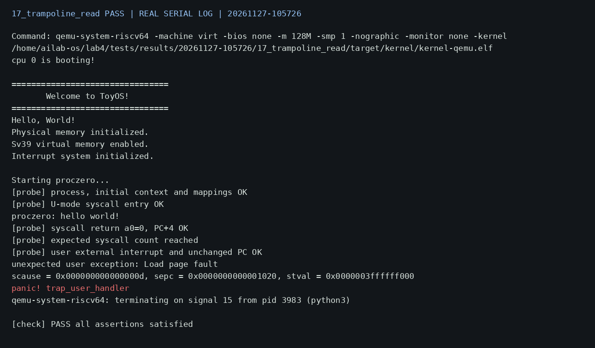

### `18_stack_execute`：用户栈执行指令

[串口日志](../../tests/results/20261127-105726/18_stack_execute.log) · [编译日志](../../tests/results/20261127-105726/18_stack_execute.build.log)


### `19_stack_below`：用户栈下界外读取

[串口日志](../../tests/results/20261127-105726/19_stack_below.log) · [编译日志](../../tests/results/20261127-105726/19_stack_below.build.log)


### `20_code_after`：代码页上界外读取

[串口日志](../../tests/results/20261127-105726/20_code_after.log) · [编译日志](../../tests/results/20261127-105726/20_code_after.build.log)


### `21_stack_endpoints`：用户栈首尾字节

[串口日志](../../tests/results/20261127-105726/21_stack_endpoints.log) · [编译日志](../../tests/results/20261127-105726/21_stack_endpoints.build.log)

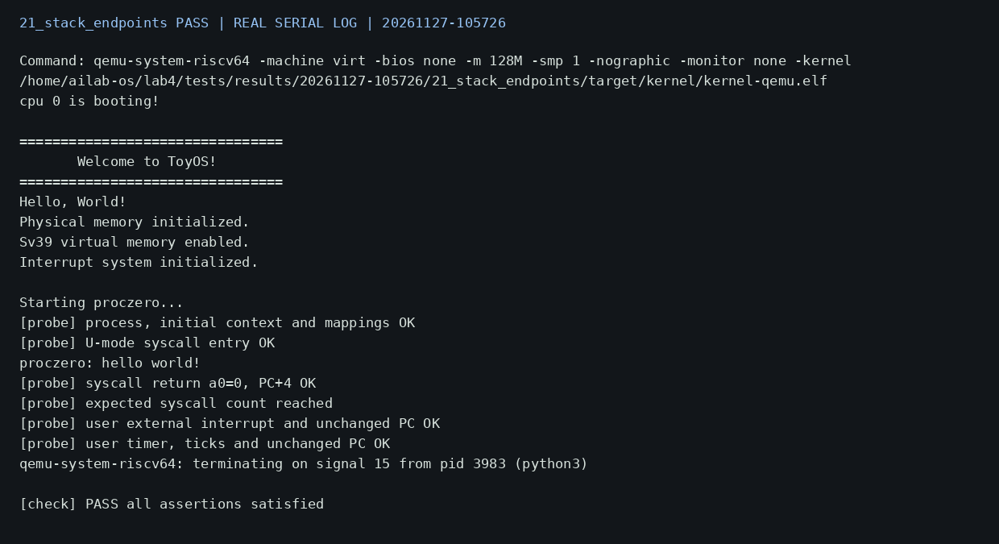

### `22_code_endpoints`：代码页首尾字节

[串口日志](../../tests/results/20261127-105726/22_code_endpoints.log) · [编译日志](../../tests/results/20261127-105726/22_code_endpoints.build.log)


### `23_trap_registers`：Trap 通用寄存器保护

[串口日志](../../tests/results/20261127-105726/23_trap_registers.log) · [编译日志](../../tests/results/20261127-105726/23_trap_registers.build.log)

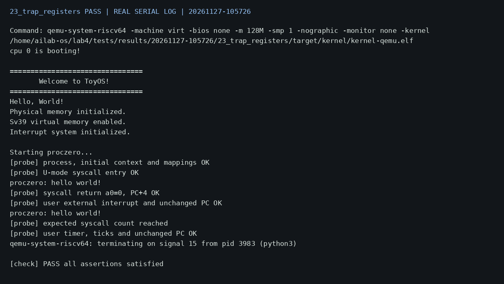

### `24_context_switch`：swtch 上下文往返

[串口日志](../../tests/results/20261127-105726/24_context_switch.log) · [编译日志](../../tests/results/20261127-105726/24_context_switch.build.log)

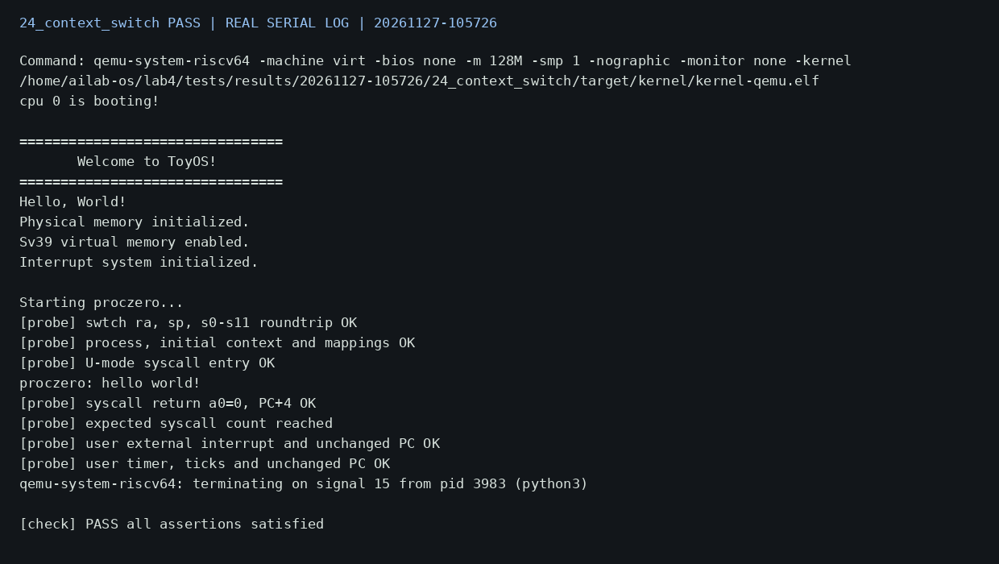

